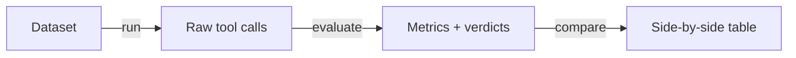

# llm-memory-bench

`llm-memory-bench` is a reproducible evaluation harness for agent memory
systems. It supports two related but separate questions:

1. **Extraction:** how well do agents and models proactively identify and
   store useful memories from interactions?
2. **Value:** how much do those memories improve downstream tasks, including
   functional, personalisation, and domain-specific workflows?

A run evaluates a model, memory prompt and tool contract, memory setup, task
dataset, and execution runtime together. The harness lets you compare
memory-system designs, prompts, models, and integrations while keeping the
relevant experiment inputs constant. Real runtimes and integrations validate
how results transfer beyond simulated tool execution; they are supporting
paths for the two benchmark aims, not a third aim.

Extraction supports both [AlpsBench](https://huggingface.co/datasets/Cosineyx/Alpsbench)
and BFCL Memory conversations. AlpsBench provides turn-level storage
annotations. BFCL Memory combines proactive storage with later retrieval; this
repository can convert it to cumulative, inferred extraction data for
complementary analysis. The two datasets use different ground-truth models.
Value runs use generated or curated scenarios and can also use τ²-bench or
CL-Bench sources.
The same experiment model can run against simulated memory tools, real
containerised integrations, or the direct OpenShift demo.

**What this project is not:** it is not a single memory product, a generic
MCP/tool-calling leaderboard, or proof that a simulated tool call was persisted
by a live backend. Simulated runs isolate model and prompt behaviour; real
integration runs test the deployed memory stack.

**Execution modes** (how you run them):

- **Simulated-tool** (`run`, `value-run`) — Direct provider calls with simulated memory tools. The benchmark provides the system prompt and tool schemas (from `src/llm_memory_bench/systems/`), intercepts tool calls, and simulates success responses. Fast iteration, works with any LLM provider. Supports both extraction and value benchmarks.

- **Real-system/containerised** (`bench`, `container-value-run`) — Real agent + real memory system integration testing. Runs Claude Code (or other agents) with actual memory systems installed via MCP inside Docker. The agent makes real tool calls, data is actually stored, and we query what was saved.

- **Direct OpenShift** (Streamlit UI) — Paired API agents use separate Kubernetes MCP endpoints and an independent `oc` verifier against a live cluster. This is a specialised operational demo, not a replacement for the extraction/value runners.

The axes are intentionally separate: extraction and value are benchmark families;
simulated-tool and containerised execution are runtimes; τ² and CL-Bench are
additional value sources; and the OpenShift demo has its own live-cluster
runtime.

| Benchmark track or supporting path | Main entry point | What it needs |
|---|---|---|
| Extraction | `run` → `evaluate` | Provider API key; AlpsBench conversion |
| Value: local scenarios | `value-generate`/`value-run` | Provider API keys; scenario YAML |
| Value: τ² source | `tau2-value-run` or `tau2-container-run` | τ² data/runtime, or the pinned container |
| Value: CL-Bench source | `clbench-setup` → `clbench-value-run` | Optional Python 3.13 checkout/runtime |
| Integration: real extraction | `bench` | Docker/Podman; container config |
| Integration/value demo: OpenShift | Streamlit UI, select **OpenShift demo** | OpenShift cluster, MCP services, `oc`, MemoryHub |

**Key difference:** Simulated-tool tests ask "can the LLM use these tools correctly?" Real-system/containerised tests ask "does the full agent + memory system stack work together?"

### Execution Mode Comparison (Extraction Benchmark)

```
Simulated-tool Mode                      Real-system/containerised Mode
─────────────────────────────────────   ─────────────────────────────────────
simulated_tool_extraction_runner.py    real_system_container_extraction_runner.py
  ↓                                       ↓
MemorySystem adapter                    Docker container
(Python class in src/)                  (real agent + real memory system)
  ↓                                       ↓
.system_prompt() → LLM API              Agent SDK → Claude Code
.tool_definitions() → LLM API             ↓
  ↓                                     Real MCP calls to gbrain
LLM returns tool calls                    ↓
  ↓                                     Actual storage in database
Intercepted & recorded                    ↓
  ↓                                     query.sh dumps stored data
.format_tool_result() simulates           ↓
success response                        Compared to ground truth
  ↓
Compared to ground truth

Uses: src/llm_memory_bench/systems/    Uses: systems/ (top-level)
      gbrain.py (Python class)                gbrain/ (bash scripts)
```

*Note: Value benchmark uses the same execution modes but measures quality/efficiency instead of extraction accuracy.*

See [docs/architecture.md](docs/architecture.md) for diagrams and detailed design.

## Install

```bash
pip install -e .
```

Requires Python 3.11+. Add only the optional features you need:

```bash
# CLI extraction/value runs with the local embedding matcher
pip install -e '.[embedding]'

# Streamlit UI plus local embedding evaluation
pip install -e '.[ui,embedding]'

# Live MemoryHub support for τ² runs
pip install -e '.[memoryhub]'
```

The real-system/containerised benchmarks require Docker or Podman. τ² and
CL-Bench have additional runtime requirements described in
[docs/tau2-value.md](docs/tau2-value.md) and [docs/clbench.md](docs/clbench.md).

Set the provider credential before running an API-backed experiment. The
benchmark reads the value but does not write it to result files:

```bash
export OPENAI_API_KEY="..."
```

### Optional benchmark UI

The Streamlit UI provides a guided run-definition and execution layer over the
existing benchmark engines. It supports extraction, simulated value, real
container value, τ², CL-Bench, and the OpenShift operational demo. It writes
UI-launched results to `results/ui/`.

```bash
pip install -e '.[ui]'
llm-memory-bench-ui
```

For a pipx-installed launcher, add the optional UI dependency to its existing
environment:

```bash
pipx inject llm-memory-bench 'streamlit>=1.40.0'
```

See [docs/ui-quickstart.md](docs/ui-quickstart.md).

## Terminology

**Memory system** has multiple meanings in this project:

1. **Conceptual:** A product/service that provides memory capabilities (e.g., GBrain MCP server, Claude Code auto-memory, MemoryHub)

2. **Simulated-tool adapter:** Python classes in `src/llm_memory_bench/systems/` that bundle:
   - The actual system prompt a memory system uses
   - The actual tool schemas (MCP format)
   - Logic to extract facts from tool calls
   - Used by: simulated-tool execution (`run`, `value-run`)

3. **Real-system integration:** Either legacy container scripts in top-level
   `systems/` or a versioned full-stack profile under `integrations/profiles/`
   that:
   - Install the real memory system (`install.sh`)
   - Configure the real agent/MCP surface
   - Query or verify what was stored
   - Reset state between tests when supported
   - Used by: real-system/containerised execution (`bench`, `container-value-run`)

Simulated-tool adapters are Python classes for fast testing. Real-system
profiles and scripts exercise the deployed agent and memory integration.

```
project root/
├── src/llm_memory_bench/
│   └── systems/              ← Simulated-tool (Python classes)
│       ├── base.py
│       ├── gbrain.py         ← GBrainMemorySystem class
│       └── simple.py
│
└── systems/                  ← Real-system/containerised (bash scripts)
    ├── gbrain/
    │   ├── install.sh        ← npm install gbrain
    │   └── query.sh          ← gbrain recall --json
    └── claude-code-memory/
```

## Quick start

### 1. Run a small extraction experiment

This is the shortest path to a reproducible result. It converts two AlpsBench
conversations, runs a simulated-tool extraction, and evaluates the saved run.
The converted Task 1 dataset uses cumulative ground truth, so pass the dataset
explicitly during evaluation.

```bash
pip install -e '.[embedding]'
export OPENAI_API_KEY="..."

llm-memory-bench convert \
  --source alpsbench \
  --output datasets/converted/smoke \
  --max-conversations 2

llm-memory-bench run \
  --dataset datasets/converted/smoke/alpsbench-task1.yaml \
  --system memoryhub \
  --provider openai \
  --model gpt-4o \
  --max-conversations 2 \
  --output results/smoke/run.json

llm-memory-bench evaluate results/smoke/run.json \
  --dataset datasets/converted/smoke/alpsbench-task1.yaml \
  --matcher embedding \
  --output results/smoke/eval_embedding.json
```

The run and evaluation are separate artifacts. Use
`llm-memory-bench compare` only when you have two or more evaluation files,
for example after evaluating two systems:

```bash
llm-memory-bench compare \
  results/simple/eval_embedding.json \
  results/memoryhub/eval_embedding.json
```

Use `llm-memory-bench list-systems` to see the complete current adapter list.

### 2. Run a paired simulated value experiment

Use the checked-in quick scenario when you want to test whether memory changes
task outcomes rather than storage decisions:

```bash
llm-memory-bench value-run \
  --scenarios scenarios/quick-demo-goal.yaml \
  --system memoryhub \
  --provider openai \
  --model gpt-4o \
  --max-scenarios 1 \
  --output results/value-smoke.json

llm-memory-bench value-visualize results/value-smoke.json
```

`value-run` evaluates the paired arms during the run. There is no separate
`value-evaluate` or `value-compare` command. Its default
`--memory-setup-mode` is `none`; choose `seeded` or `capture_first` when that
is part of the experiment design.

### 3. Use the UI for the complete experiment menu

```bash
pip install -e '.[ui,embedding]'
llm-memory-bench-ui
```

The UI exposes the same `RunSpec`/`RunService` boundary for extraction, value,
τ², CL-Bench, and the OpenShift demo. See
[docs/ui-quickstart.md](docs/ui-quickstart.md) for the provider, container,
live MemoryHub, and cluster-specific setup.

### 4. Run a real container integration

```bash
llm-memory-bench bench configs/claude-gbrain.yaml
```

For the versioned Claude Code + remote MemoryHub profile, use
`configs/claude-memoryhub-remote.yaml` instead. Container runs need Docker or
Podman and the credentials referenced by the selected YAML config.

## Memory systems (simulated-tool)

Each simulated-tool memory system bundles a prompt, tool schemas, and extraction logic inspired by real memory systems. Different prompt designs frame the judgment differently — flat facts vs typed categories vs hierarchical pages — letting you test whether prompt design affects proactive tool-calling quality.

These are Python adapter classes in `src/llm_memory_bench/systems/` used by simulated-tool execution.

```bash
llm-memory-bench list-systems
```

| System | Description |
|--------|-------------|
| `simple` | Basic proactive system: `add_memory(fact, category)` with explicit storage guidance |
| `simple_sweep` | Turn-by-turn extraction plus a final sweep pass |
| `claude_code` | Claude Code's auto-memory: typed memories (user/feedback/project/reference) with structured `save_memory` tool |
| `gbrain` | GBrain MCP knowledge-brain: `put_page` with slug-organized markdown pages + `capture` for quick one-liners |
| `gbrain_sweep` | GBrain turn-by-turn extraction plus a final sweep pass |
| `hindsight` | Hindsight retain/recall/reflect memory adapter |
| `mem0` | Mem0-style automatic fact extraction |
| `memoryhub` | MemoryHub unified `memory(action=...)` dispatcher with scoped writes, weighted memories, and content type classification |
| `memoryhub_sweep` | MemoryHub turn-by-turn extraction plus a final sweep pass |
| `bfcl_memory_kv` | BFCL Memory key/value adapter; use `--scenario` where required |
| `behavioral_relevance` | STORE/SKIP behavioral relevance prompt |
| `openclaw` | OpenClaw file-backed memory: `write`/`edit` to `USER.md`, `MEMORY.md`, and `memory/YYYY-MM-DD.md` daily notes |
| `alpsbench_batch` | AlpsBench Task 1 batch baseline |

The exact descriptions and registered names come from the installed package;
`list-systems` is authoritative.

## Benchmarks

### Extraction benchmark

Tests **proactive tool-calling judgment**: can the LLM identify implicit triggers in noisy conversation and call the memory tool unprompted, at the right time, with the right content?



The workflow has three steps:

#### 1. Run (capture tool calls)

```bash
llm-memory-bench run \
  --dataset datasets/converted/alpsbench-task1.yaml \
  --system <simple|claude_code|gbrain> \
  --provider <anthropic|vertex|openai|litellm> \
  --model <model-id> \
  --output results/run.json
```

Feeds conversations through the LLM and captures raw tool calls. Does not compute metrics.

**Options:**

| Flag | Default | Description |
|------|---------|-------------|
| `--dataset` | *(required)* | Path to converted dataset YAML |
| `--system` | `simple` | Memory system to benchmark |
| `--provider` | `openai` | LLM provider |
| `--model` | `gpt-4o` | Model to test |
| `--max-conversations` | all | Limit conversations for quick tests |
| `--max-total-tokens` | none | Stop after this many reported input plus output tokens |
| `--max-cost-usd` | none | Stop after this estimated USD spend |
| `--dry-run-estimate` | false | Show estimated usage without calling the provider |
| `--output` | auto-generated | Output path for run data |
| `--api-key-env` | auto | Env var name for the API key |

Budget controls are cumulative across all API calls. The estimate is approximate; the run output records actual provider-reported token usage. If both limits are supplied, the run stops when either limit is reached. Cost limits require pricing data for the selected model.

#### 2. Evaluate (compute metrics)

```bash
llm-memory-bench evaluate results/run.json \
  --matcher <embedding|llm|hybrid> \
  --dataset datasets/converted/alpsbench-task1.yaml
```

Compares captured tool calls against ground truth using semantic matching. Computes precision, recall, F1, noise resistance, and schema validity.

**Options:**

| Flag | Default | Description |
|------|---------|-------------|
| `RUN_FILE` | *(required)* | Path to run output from step 1 |
| `--dataset` | from run file | Path to dataset (optional if run file has embedded ground truth) |
| `--matcher` | `embedding` | Fact matching strategy: `embedding` (fast, local), `llm` (semantic, requires judge), or `hybrid` (two-stage) |
| `--judge-provider` | from run | Provider for LLM/hybrid matcher |
| `--judge-model` | from run | Model for LLM/hybrid matcher |
| `--output` | auto-generated | Output path for evaluation results |
| `--api-key-env` | auto | Env var name for the API key |

**Matchers:**

- **`embedding`** (default) — Fast, local, no API costs. Uses sentence embeddings to match facts. May miss paraphrases.
- **`llm`** — Semantic understanding via LLM judge. Requires `--judge-provider` and `--judge-model`. Slow but accurate.
- **`hybrid`** — Two-stage: embedding filter + LLM for uncertain cases. Requires judge config. 75-80% cost reduction vs pure LLM. See [docs/hybrid-matcher.md](docs/hybrid-matcher.md).

#### 3. Compare (view results)

```bash
llm-memory-bench compare results/system-a/eval_embedding.json results/system-b/eval_embedding.json
```

Prints side-by-side metrics across multiple evaluations.

**Metrics:**

- **extraction_precision** — of all tool calls made, how many matched expected facts
- **extraction_recall** — of all expected facts, how many were captured by tool calls
- **extraction_f1** — harmonic mean of precision and recall
- **noise_resistance_rate** — fraction of noise turns where no tool was called
- **schema_validity_rate** — fraction of tool calls with valid arguments per the schema

See [docs/metrics.md](docs/metrics.md) for detailed definitions, formulas, interpretation guide, and comparison to BFCL metrics.

### Value benchmark

Tests whether stored memories actually improve task performance. Generates scenarios from conversations, then runs paired trials — one with memory and one without — to measure the delta.

```bash
# Generate scenarios (one-time, uses an LLM)
llm-memory-bench value-generate \
  --source alpsbench \
  --output scenarios \
  --max-scenarios 50

# Run paired trials
llm-memory-bench value-run \
  --scenarios scenarios \
  --system gbrain \
  --mode prompt \
  --max-turns 10 \
  --output results/value-run.json
```

**Options for `value-run`:**

| Flag | Default | Description |
|------|---------|-------------|
| `--scenarios` | *(required)* | Path to generated scenarios |
| `--system` | `simple` | Memory system to use |
| `--mode` | `prompt` | How memories are injected: `prompt` (in system prompt), `tool` (via recall tool), or `both` |
| `--memory-setup-mode` | `none` | No memory setup by default; use `seeded` or `capture_first` explicitly |
| `--max-turns` | `10` | Max conversation turns per trial |
| `--user-sim-provider` | same as `--provider` | Provider for the simulated user |
| `--user-sim-model` | same as `--model` | Model for the simulated user |
| `--max-scenarios` | all | Limit scenarios for quick tests |

## Baseline comparison

To isolate **proactive judgment** from general tool-calling ability, compare against [BFCL](https://gorilla.cs.berkeley.edu/leaderboard.html) (Berkeley Function Calling Leaderboard):

```bash
# Install BFCL
pip install bfcl

# Run baseline (explicit function requests)
bfcl generate --model claude-sonnet-4-20250514 --test-category live_simple
bfcl evaluate --model claude-sonnet-4-20250514 --test-category live_simple

# Run memory benchmark (proactive judgment)
llm-memory-bench run \
  --dataset datasets/converted/alpsbench-task1.yaml \
  --system memoryhub \
  --provider anthropic \
  --model claude-sonnet-4-20250514 \
  --output results/bfcl-comparison/run.json

llm-memory-bench evaluate results/bfcl-comparison/run.json \
  --dataset datasets/converted/alpsbench-task1.yaml \
  --matcher embedding \
  --output results/bfcl-comparison/eval_embedding.json

# Compare scores
cat ~/.cache/bfcl/result/claude-sonnet-4-20250514/live_simple_score.json
cat results/bfcl-comparison/eval_embedding.json
```

**The gap** between BFCL accuracy and AlpsBench recall represents the cost of proactive judgment. If BFCL scores are high but memory extraction is low, the model can execute tools correctly when told to, but struggles to identify what's worth storing in natural conversation.

See [docs/baseline-comparison.md](docs/baseline-comparison.md) for detailed analysis.

## Prompt design comparison

Compare registered simulated-tool systems with the same dataset, provider, and
model. For example, compare a simple prompt, MemoryHub's prompt, and the
behavioral-relevance prompt:

```bash
for sys in simple memoryhub behavioral_relevance; do
  llm-memory-bench run \
    --dataset datasets/converted/alpsbench-task1.yaml \
    --system "$sys" \
    --provider vertex \
    --model claude-sonnet-4@20250514 \
    --output "results/prompt-comparison/$sys/run.json"
done

# Step 2: Evaluate all runs with the same matcher
for sys in simple memoryhub behavioral_relevance; do
  llm-memory-bench evaluate "results/prompt-comparison/$sys/run.json" \
    --dataset datasets/converted/alpsbench-task1.yaml \
    --matcher embedding \
    --output "results/prompt-comparison/$sys/eval_embedding.json"
done

# Step 3: Compare
llm-memory-bench compare results/prompt-comparison/*/eval_embedding.json
```

Keep the comparison empirical: prompt performance depends on the model,
dataset, matcher, and tool schema. This isolates the **value of proactive
prompt design** from model changes without assuming fixed recall percentages.

See [docs/prompt-comparison.md](docs/prompt-comparison.md) for the detailed workflow and interpretation.

### Real-system/containerised mode

Runs benchmarks through the full stack: a real coding agent (Claude Code) with a real memory system (gbrain, Claude Code auto-memory) installed inside Docker. Instead of intercepting tool calls at the API layer, the agent uses the memory system for real and we query what was stored afterward.

**Currently supports:** Extraction benchmark and paired value runs for the
versioned Claude Code + MemoryHub integration profile. The OpenShift
operational demo is a separate Streamlit/direct-cluster path described in
[docs/ui-quickstart.md](docs/ui-quickstart.md).

```bash
llm-memory-bench bench configs/claude-gbrain.yaml
```

This builds a Docker image with the host agent pinned to a specific version, installs the memory system via bash scripts from top-level `systems/` directory, feeds conversations through the agent, then queries what was actually stored.

**Note:** Real-system/containerised mode does NOT use the Python `MemorySystem` adapters. It installs and queries real memory systems via bash scripts. This is true regardless of which benchmark (extraction or value) runs in the container.

#### Versioned full-stack integration profiles

New full-agent integrations use a versioned profile instead of creating a
memory-system-specific image. A profile materializes the platform's complete
configuration surface: MCP transport, rules, hooks, plugins/scripts,
dependencies, permissions, runtime environment, lifecycle, and verification.

The first profile is Claude Code + remote MemoryHub:

```bash
llm-memory-bench bench configs/claude-memoryhub-remote.yaml
```

The MemoryHub container configuration appends the checked-in Claude Code
memory prompt snapshot from `prompts/claude_code/v1_2026-08.yaml` to the
runtime's Claude Code preset. Container configs can control this with:

```yaml
container:
  system_prompt_file: prompts/claude_code/v1_2026-08.yaml
  system_prompt_mode: append  # or replace
```

`append` preserves Claude Code's normal runtime prompt and adds the benchmark
prompt. `replace` uses only the supplied prompt text.

For a real integrated value run, use a value scenario file and the container
configuration. This runs a baseline Claude Code trial and a separate trial
with scenario memories seeded into MemoryHub before the agent starts:

```bash
llm-memory-bench container-value-run \
  --config configs/claude-memoryhub-remote.yaml \
  --scenarios scenarios/test-value.yaml \
  --max-scenarios 1 \
  --user-sim-provider openai \
  --judge-provider openai
```

All value runtimes support two memory setup modes:

- `seeded`: the baseline starts without memories and the memory arm receives
  the scenario's declared memory bank.
- `capture_first`: the baseline starts cold with memory-writing enabled; its
  captured writes are handed to the memory arm.

The user simulator still receives scenario/task context in both modes. That
context is not automatically treated as agent memory.

The existing `value-run` command remains simulated-tool execution and uses simulated memory
adapters. It is not equivalent to `container-value-run`.

For faithful τ² Value experiments, use `tau2-value-run`. It calls the real τ²
Python runner for the domain environment, user simulation, tools, and reward,
then adds matched baseline/memory arms and harness telemetry. See
[docs/tau2-value.md](docs/tau2-value.md).

For a self-contained setup without a local τ² Python environment, use
`tau2-container-run`. It builds a pinned Python/τ² image on first use and
passes only the model credentials through from the host.

```yaml
host:
  name: claude-code
  version: "1.0.33"

integration:
  profile: integrations/profiles/memoryhub/remote-http-v1/profile.yaml
  platform: claude-code
  env:
    MEMORYHUB_URL: "${MEMORYHUB_URL}"
    MEMORYHUB_API_KEY: "${MEMORYHUB_API_KEY}"
```

The remote MemoryHub profile currently supports one isolated conversation per
container. It fails multi-conversation reuse because remote MemoryHub does not
yet provide a generic benchmark reset and a project ID alone cannot force all
agent writes into that project. See
[docs/container-integration-profiles.md](docs/container-integration-profiles.md).

**Config format** (`configs/claude-gbrain.yaml`):

```yaml
host:
  name: claude-code
  version: "1.0.33"

system:
  name: gbrain
  version: "0.46.19.0"
  env:
    GBRAIN_SURFACE: starter

model: claude-sonnet-4@20250514

dataset: datasets/converted/task1.jsonl

max_conversations: 10
```

**Project layout for real-system/containerised benchmarks:**

```
hosts/
  claude-code/
    Dockerfile        # Base image: node + Claude Code CLI + Agent SDK
    entrypoint.sh     # Runs system installer on container start
    driver.py         # Feeds conversations via Claude Agent SDK

systems/
  gbrain/
    install.sh        # npm install + claude mcp add
    cleanup.sh        # Reset stored data between conversations
    query.sh          # Dump what was stored as JSON
  claude-code-memory/
    install.sh        # Configure auto-memory
    cleanup.sh
    query.sh

configs/
  claude-gbrain.yaml
  claude-memory.yaml
```

## Comparing results

```bash
llm-memory-bench compare path/to/eval-one.json path/to/eval-two.json
```

Prints a side-by-side table of all metrics across evaluations, labeled by provider/model/system. Can also compare run files directly (without evaluation), but metrics will be limited.

## Datasets

### AlpsBench extraction data

[AlpsBench](https://huggingface.co/datasets/Cosineyx/Alpsbench) provides
conversations with human-verified memory items linked to source utterances.

- **Task 1 (Extraction):** Given a conversation, identify which facts to store
- **Task 2 (Updating):** Given a conversation and existing memories, identify new or updated facts

```bash
# Full dataset (English only by default)
llm-memory-bench convert --source alpsbench

# Small subset for testing
llm-memory-bench convert --source alpsbench --max-conversations 10

# Include all languages
llm-memory-bench convert --source alpsbench --all-languages
```

### BFCL Memory data

BFCL Memory provides domain-specific prerequisite conversations and later
retrieval questions. The repository can convert it into cumulative datasets
for complementary extraction analysis. This requires a clone of the
BFCL/Gorilla repository:

```bash
git clone https://github.com/ShishirPatil/gorilla.git

llm-memory-bench convert \
  --source bfcl-memory \
  --bfcl-repo /path/to/gorilla \
  --output datasets/converted/bfcl
```

The converter produces inferred cumulative labels, so BFCL results should not
be compared directly with AlpsBench's turn-level metrics. See
[docs/bfcl-memory-category.md](docs/bfcl-memory-category.md) for details.

## Providers

| Provider | `--provider` value | Auth | Notes |
|----------|-------------------|------|-------|
| Anthropic | `anthropic` | `ANTHROPIC_API_KEY` | Claude models via direct API |
| Vertex AI | `vertex` | `ANTHROPIC_VERTEX_PROJECT_ID`, application default credentials, optional `CLOUD_ML_REGION` | Claude models via Vertex AI; default region is `us-east5` |
| OpenAI | `openai` | `OPENAI_API_KEY` | GPT models |
| LiteLLM | `litellm` | varies | Gemini, Mistral, Ollama, Bedrock, etc. |

## Adding a memory system

### Adding a simulated-tool adapter

Create a new file in `src/llm_memory_bench/systems/` implementing the `MemorySystem` base class:

```python
from llm_memory_bench.systems.base import MemorySystem
from llm_memory_bench.providers.base import ToolCall

class MyMemorySystem(MemorySystem):
    name = "my_system"
    description = "Description shown in list-systems"

    def system_prompt(self) -> str:
        """Return the actual system prompt your memory system uses."""
        return "..."

    def tool_definitions(self) -> list[dict]:
        """Return the actual tool schemas your system exposes."""
        return [{"name": "...", "description": "...", "input_schema": {...}}]

    def extract_stored_fact(self, tool_call: ToolCall) -> str:
        """Extract the semantic content from a tool call for evaluation."""
        return tool_call.arguments.get("content", "")

    def format_tool_result(self, tool_call: ToolCall) -> dict:
        """Return what your system would respond with."""
        return {"status": "ok"}
```

Then register it in `src/llm_memory_bench/systems/__init__.py`.

### Adding a real-system/containerised system

Create a directory in top-level `systems/` with three bash scripts:

```bash
systems/my_system/
├── install.sh    # Install and configure the real memory system
├── query.sh      # Output stored data as JSON to stdout
└── cleanup.sh    # Reset state between conversations
```

**install.sh** example:
```bash
#!/usr/bin/env bash
set -euo pipefail

npm install -g my-memory-system
claude mcp add my-system -- my-system serve
```

**query.sh** example:
```bash
#!/usr/bin/env bash
set -euo pipefail

# Query the real system and output JSON
my-system dump --format json
```

**cleanup.sh** example:
```bash
#!/usr/bin/env bash
set -euo pipefail

my-system reset
```

Then create a config file in `configs/`:

```yaml
host:
  name: claude-code
  version: "1.0.33"

system:
  name: my_system    # Must match directory name in systems/

model: claude-sonnet-4@20250514
dataset: datasets/converted/alpsbench-task1.yaml
```

## Example: comparing systems across models

```bash
# Step 1: Run benchmark for each system/model combination
for sys in simple claude_code gbrain; do
  llm-memory-bench run \
    --dataset datasets/converted/alpsbench-task1.yaml \
    --system $sys \
    --provider vertex \
    --model claude-sonnet-4@20250514 \
    --output "results/model-comparison/vertex/$sys/run.json"
done

for sys in simple claude_code gbrain; do
  llm-memory-bench run \
    --dataset datasets/converted/alpsbench-task1.yaml \
    --system $sys \
    --provider openai \
    --model gpt-4o \
    --output "results/model-comparison/openai/$sys/run.json"
done

# Step 2: Evaluate all runs
for provider in vertex openai; do
  for sys in simple claude_code gbrain; do
    llm-memory-bench evaluate \
      "results/model-comparison/$provider/$sys/run.json" \
      --dataset datasets/converted/alpsbench-task1.yaml \
      --matcher embedding \
      --output "results/model-comparison/$provider/$sys/eval_embedding.json"
  done
done

# Step 3: Compare all evaluations
llm-memory-bench compare results/model-comparison/*/*/eval_embedding.json
```
