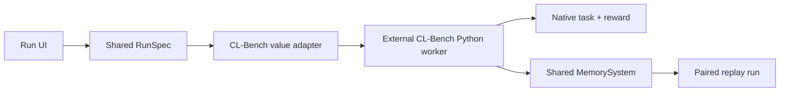

# Continual Learning Bench adapter

CL-Bench is an optional value-benchmark source. Its task lifecycle and native
task evaluator remain authoritative; this project supplies the system adapter
and memory protocol.

## One-time setup

Run this once per checkout/environment:

```bash
llm-memory-bench clbench-setup
```

The command clones the official checkout into `.cl-bench`, creates its virtual
environment, installs the upstream package, and downloads the selected task's
artifacts. It is deliberately explicit rather than a `pip install` hook because
the database artifacts are large and require network access. Subsequent runs
only validate and reuse the checkout.



The worker is isolated because the official CL-Bench package currently requires
Python 3.13 and has a top-level `src` package. Configure the checkout root and
its interpreter in the UI. When the interpreter is blank, the adapter uses
`<checkout>/.venv/bin/python`.

The three value modes are:

- `none`: one stateless control run; no memory system is loaded.
- `seeded`: run the control, then run the same task with the selected seed-memory file.
- `capture_first`: run the task with the selected memory system in capture-only mode, then rerun the same task with the captured snapshot replayed.

The returned result preserves CL-Bench's `TaskResult` and system artifacts and
adds `comparison.baseline_score`, `comparison.memory_score`, and
`comparison.gain`. For the first slice, the UI exposes
`database_exploration`; more tasks can be added by extending the task selector,
not by changing the harness contract.

## Native CL-Bench learning lifecycle

CL-Bench has a native baseline/rollout distinction. It does not natively run a
memory-capture phase followed by a memory-replay phase.

- **Native baseline:** each question is evaluated with a fresh system. The
  system receives SQL results while solving that question and receives
  correctness, ground truth, and query-count feedback after its final answer.
  That final feedback is recorded for scoring and trace analysis, but is not
  carried into the next question.
- **Native rollout:** questions run as one continual sequence. Feedback from a
  completed question can influence later questions through the system's retained
  state. The database-exploration score measures whether exploratory queries
  decrease over the sequence.
- **Within either mode:** a `QUERY` receives SQL-result feedback immediately;
  an `ANSWER` completes the question and produces the correctness feedback.

The task never calls a memory tool or tells the system to store a fact. Memory
storage is the responsibility of the evaluated system.

### Current execution modes

| Configuration | What runs | Cross-question context | External memory | Role |
|---|---|---:|---:|---|
| `none` | One no-memory run | No | No | Stateless control only |
| `seeded` | No-memory run + seeded replay | No in both | Replay only | Stateless control vs external-memory replay |
| `capture_first` | Capture pre-pass + captured-memory replay | No in both | Capture writes; replay reads/writes | Generate memories, then test external-memory replay |
| Native CL-Bench rollout | One continual run | Yes | No | Native continual-learning control |
| Combined arm | One continual run with memory | Yes | Yes | Test memory value beyond conversation context |

The current `capture_first` implementation does **not** include a clean
stateless control score and does **not** run a combined context-plus-memory
arm. The capture pre-pass is preparation, not a baseline outcome arm. A
proper captured-memory value comparison requires:

```text
capture pre-pass → stateless no-memory control replay
                 → external-memory replay
```

The two tracked follow-ups are:

1. Replace per-turn driver/Claude process creation with a persistent worker per
   benchmark phase, while retaining explicit session resets between questions.
2. Create a tailored, versioned CL-Bench capture prompt that explicitly
   requires `memory(action="write")` for reusable schema/domain facts while
   preserving the required `QUERY`/`ANSWER` response format.

## Capture-only and replay state boundaries

`capture_first` is an llm-memory-bench protocol layered around the native task:

```mermaid
sequenceDiagram
  participant T as CL-Bench task
  participant C as Capture Claude session
  participant S as Capture MemoryHub project
  participant R as Replay Claude session
  participant P as Replay MemoryHub project

  loop each question
    T->>C: question + prior feedback for current question
    C->>T: QUERY/ANSWER; optional memory write
    T-->>C: SQL result or final correctness feedback
    C->>S: durable writes only
    Note over C: session reset after question
  end
  S-->>P: captured snapshot
  loop each replay question
    T->>R: question + prior feedback for current question
    R->>P: explicit memory search/read
    P-->>R: relevant memories
    R->>T: QUERY/ANSWER
    Note over R: session reset after question
  end
```

The current real-container capture and replay arms use
`reset_between_instances=True`:

- Claude conversation context is retained across `QUERY`/`ANSWER` turns within
  one question.
- After a question completes, the Claude session is reset before the next
  question.
- MemoryHub project state persists across questions and is the only intended
  cross-question bridge.
- In capture, the proxy suppresses reads and forwards writes.
- In replay, the proxy forwards reads and writes against the replay project.
- Proxy mode disables the direct SessionStart memory-loading hook, so replay
  must explicitly call the MCP memory tools to recover stored facts.

This isolates external-memory value, but it also creates an important limitation:
a fact that is merely present in Question 1's conversation or injected context
is gone for Question 2. It survives only if capture writes it to MemoryHub and
replay reads it in the new session. The capture prompt must therefore explicitly
instruct the agent to write durable facts during the task; CL-Bench does not
provide that instruction itself.

### Follow-up concerns

- **Driver efficiency:** each CL-Bench response currently starts a new driver
  and Claude process, then resumes the session. A persistent worker should be
  used per phase while retaining explicit resets between questions.
- **Capture quality:** a tailored, versioned CL-Bench capture prompt should
  explicitly require `memory(action="write")` for reusable schema/domain facts
  while preserving the required final `QUERY`/`ANSWER` JSON.
- **Native-rollout comparison:** if the experiment should measure native
  continual learning plus memory rather than isolated external-memory value,
  run a separate configuration with `reset_between_instances=False` and label
  it accordingly.
- **Proxy audit visibility:** the shared HTTP proxy writes its audit on the
  host, while the container artifact collector currently reads the container
  path. The host audit must be surfaced explicitly or the stored artifact may
  appear empty even when proxy events occurred.

The container adapter now passes the CL-Bench response schema through the
Claude Agent SDK `output_format` channel. It does not add schema or JSON
serialization instructions to the task prompt. The SDK returns structured
output, and the benchmark validates it as `DatabaseAction`.

The adapter also forwards each `Observation` to the next `respond()` call.
That includes the SQL result after a `QUERY`; `reset()` clears pending
feedback when the run uses isolated questions.

## Real-system container runtime

Select `Real-system container` for CL-Bench when the task should exercise the
actual agent, prompt stack, and MemoryHub MCP integration. The CL-Bench task
loop and evaluator stay in the benchmark process; only the system's
`respond()` call crosses into the container.

Both arms use one host-side HTTP proxy deployment. The proxy forwards the
upstream MemoryHub tool definitions unchanged and applies only the request
policy. The arm and project are sent as headers on the agent's MCP request.

```mermaid
sequenceDiagram
  participant O as CL-Bench runner
  participant P as Shared MCP proxy
  participant A as Agent container
  participant M as MemoryHub MCP

  O->>P: start once for paired run
  O->>A: start capture container + arm=capture
  A->>P: tools/list + tools/call
  P->>P: suppress reads; forward writes
  P->>M: write(project=capture)
  O->>P: observe capture project
  O->>A: start replay container + arm=replay
  O->>M: seed captured snapshot(project=replay)
  A->>P: tools/list + tools/call
  P->>M: forward reads/writes(project=replay)
  O-->>O: compare native task scores
```

This prevents capture-arm read-after-write contamination while preserving the
normal replay prompt and the real upstream MCP schema. The proxy audit JSONL
should be surfaced with the run artifacts so suppressed reads and forwarded
writes can be checked after a run.

