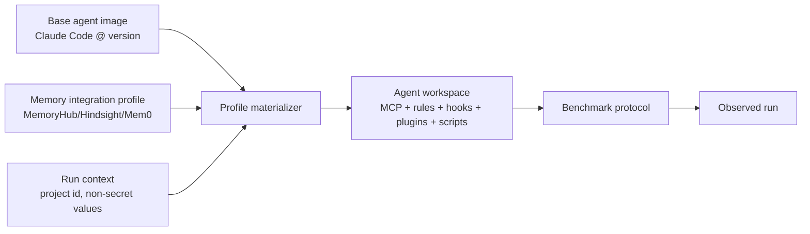

# Container integration profiles

An integration profile is the versioned materialized configuration of one
memory system on one agent platform. It is separate from both the agent base
image and the benchmark protocol.



## Current vertical slice

`integrations/profiles/memoryhub/remote-http-v1/profile.yaml` materializes the
real Claude Code surface:

- `.memoryhub.yaml`, including a run-specific `project_id`;
- generated-style MemoryHub loading instructions;
- `SessionStart` hooks for startup, compact, and clear;
- a project-scoped `.mcp.json` stdio bridge to the remote HTTP MCP server;
- an authenticated MCP bridge that registers the remote API-key session without
  placing the key in the agent prompt;
- the pinned `memoryhub-cli` runtime dependency declaration;
- a static observation command and an explicit reset contract.

Use it from Python:

```python
from llm_memory_bench.integrations import (
    MaterializationContext,
    load_profile,
    materialize_profile,
)

profile = load_profile(
    "integrations/profiles/memoryhub/remote-http-v1/profile.yaml"
)
result = materialize_profile(
    profile,
    "claude-code",
    "/tmp/agent-workspace",
    MaterializationContext(project_id="bench-20261012-session-001"),
)
```

The materializer never writes secret values. Environment placeholders remain
in MCP configuration and hooks/bridge resolve credentials at runtime. The
bridge is needed because MemoryHub API-key authentication is a tool-level
`register_session` operation, not an HTTP `Authorization` header.

The profile pins its Python runtime packages, but does not yet carry wheel
hashes or an offline package cache. Exact offline reproducibility is the next
dependency-management step, not something the base image can guarantee.

## Deliberate limitation

The remote MemoryHub profile declares reset as unsupported. A project ID makes
observation and campaign scoping possible, but it does not force every
agent-initiated write into that project. A benchmark runner must not claim
cross-conversation isolation until one of these is available:

1. a provider-side project ID/reset adapter;
2. a dedicated MemoryHub account or project with an audited cleanup path; or
3. a protocol that requires exactly one isolated conversation per container.

This is a provider contract issue, not something the image or MCP config can
solve by itself.

## Extension rule

New systems should add another versioned profile, not another base image. A
profile may declare a different topology (`remote-http`, `local-stdio`,
`sidecar-api`, or `embedded-sdk`) and a platform materializer may reject a
profile when that topology cannot be represented faithfully. Unsupported
hooks, plugins, permissions, or lifecycle operations must be reported as
unsupported rather than silently omitted.

## Benchmark-owned seeding

The memory service is currently an external dependency. Initial memory state is
owned by the benchmark, not by the agent integration profile. A run can declare
a versioned seed fixture:

```yaml
benchmark:
  seed:
    fixture: benchmarks/seeds/memoryhub-recall-v1.yaml
```

The runner applies and verifies the fixture before the first agent turn, using a
provider-specific seed adapter. The same generated project ID is passed to the
seed adapter and the materialized integration. Seed records contain provider
IDs and content hashes, while secret values are excluded.

The first adapter is MemoryHub declarative seeding through its SDK. Replay
seeding is represented in the fixture schema but intentionally fails until a
provider-specific replay adapter is implemented. This keeps replay-based
benchmarks from being mistaken for equivalent direct-state benchmarks.

## Integration event logs

The runner may expose a provider-neutral JSONL event sink to the container at
`LLM_MEMORY_BENCH_EVENT_LOG` for benchmark-owned boundary instrumentation.
The benchmark must not edit MemoryHub's client-side hooks, plugins, bridge
processes, or other system code merely to produce events. Events use the shape:

```json
{"name":"integration.context_delivery","source":"session_start_hook","status":"success","details":{"channel":"hook_stdout"}}
```

These events are separate from agent-issued MCP tool calls. A hook can load
context before the first prompt without producing an assistant tool call, but
the benchmark should report that only when it can observe the delivery from
outside the system under test. Event details must not contain memory contents,
prompts, credentials, or tool arguments by default.

For debugging a materialized integration, hook response output can be captured
without changing the provider-owned hook. Set the generic environment variable
`LLM_MEMORY_BENCH_CAPTURE_HOOK_OUTPUT=1` in the run configuration. The driver
records the hook's returned stdout under `details.hook_output`, truncated to
20,000 characters. This is opt-in because the output may contain the actual
context delivered to the agent and therefore may contain sensitive memory data.
