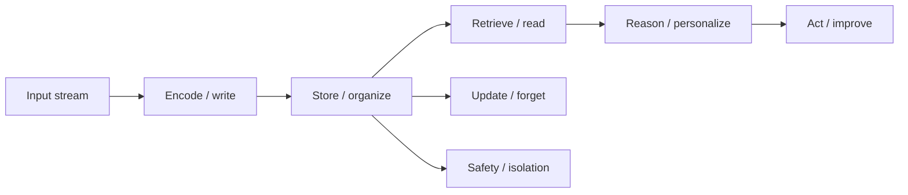

# SOTA survey: memory-related benchmarks

**Cutoff:** 2026-11-26  
**Scope:** benchmarks whose main claim concerns persistent capture, retrieval, updating, organization, forgetting, personalization, procedural reuse, multimodal/embodied memory, or parametric memorization.

## Executive judgment

There is no single state-of-the-art memory benchmark. The field has split into orthogonal measurement families:



The commonly quoted LoCoMo and LongMemEval scores mostly measure the read path: retrieve evidence and answer a question. They do not, by themselves, prove good write gating, memory hygiene, deletion, multi-user isolation, or task-level utility.

The strongest current coverage is:

- **Lifecycle and real-dialogue grounding:** [AlpsBench](https://arxiv.org/abs/2603.26680).
- **Multi-session QA, temporal state, updates, and abstention:** [LongMemEval](https://arxiv.org/abs/2410.10813), with [LoCoMo](https://aclanthology.org/2024.acl-long.747/) as the older reference point.
- **Incremental learning and forgetting:** [MemoryAgentBench](https://arxiv.org/abs/2507.05257), [Evo-Memory](https://arxiv.org/abs/2511.20857), and [MemoryBench](https://arxiv.org/abs/2510.17281).
- **Memory reliability and hallucination localization:** [HaluMem](https://arxiv.org/abs/2511.03506).
- **Extreme scale:** [BEAM](https://arxiv.org/abs/2510.27246).
- **Personalization and changing user state:** [PersonaMem](https://arxiv.org/abs/2504.14225), [Memora](https://arxiv.org/abs/2604.20006), and [PerMemBench](https://arxiv.org/abs/2605.25535).
- **Procedural/task use:** [Mem2ActBench](https://arxiv.org/abs/2601.19935), [LongMemEval-V2](https://arxiv.org/abs/2605.12493), and [STATE-Bench](https://opensource.microsoft.com/blog/2026/05/19/introducing-state-bench-a-benchmark-for-ai-agent-memory/).
- **Context-only baselines:** [RULER](https://arxiv.org/abs/2404.06654), [NoLiMa](https://proceedings.mlr.press/v267/modarressi25a.html), and [Oolong](https://arxiv.org/abs/2511.02817).

## Taxonomy by what the benchmark can establish

### 1. Working-memory and long-context utilization

These tests give the model a long input in one episode. They measure whether attention/context processing can find, combine, or aggregate information. They are essential baselines for any external-memory claim.

- **NIAH / needle-in-a-haystack:** literal retrieval at controlled positions. Good smoke test; weak evidence of memory because it rewards lexical matching and has no write lifecycle.
- **RULER:** variable numbers of needles, tracing, aggregation, and QA across length and task complexity. Better than NIAH for measuring effective context length.
- **NoLiMa:** retrieval where query and evidence have little lexical overlap; tests latent association rather than literal matching.
- **BABILong:** bAbI-style reasoning embedded in long naturalistic distractor contexts; tests long-range retrieval plus symbolic reasoning.
- **MRCR:** repeated-content retrieval and contextual discrimination; useful for multi-needle and interference sensitivity.
- **LongBench / LongBench v2:** realistic long-context QA, dialogue, code, structured data, and reasoning; broad model capability probe rather than a memory-system benchmark.
- **InfiniteBench / ∞Bench:** 100K-plus long-context tasks; useful for scale, but results mix memory with general reading and reasoning.
- **HELMET:** application-centric long-context suite across retrieval, summarization, reasoning, and generation; useful for model/context baselines.
- **Oolong:** classification/counting/aggregation over many chunks. It tests use of the whole context, not just one retrieved needle.

**What these prove:** effective context use at a specified length and task shape.  
**What they do not prove:** persistence across sessions, selective storage, update semantics, deletion, or an external memory’s value.

### 2. Long-term conversational and declarative memory

These are the canonical external-memory benchmarks: the system sees a stream of sessions and later answers about prior facts/events.

- **MSC — Multi-Session Chat:** early human-human, five-session dialogue; tests persona continuity and retrieval for re-engagement. Historical baseline, not a modern stress test.
- **DuLeMon / LeMon:** long-term mutual persona memory in human-bot dialogue; tests extraction and continuous update of both user and bot persona.
- **MemoryBank:** multi-day personal dialogue with explicit update/forgetting ideas; important early system paper, smaller evaluation set.
- **PerLTQA:** 8,593 questions over personal profiles, social relations, events, and dialogue; broad personal-memory QA with retrieval/synthesis.
- **LoCoMo:** long-term conversations with single-hop, multi-hop, temporal, open-domain, adversarial, summarization, and multimodal generation components. Widely used, but its headline score is highly sensitive to judge, answer model, retrieval budget, and harness.
- **DialSim:** multi-party TV-show simulation, randomized questioning, time limits, temporal/multi-hop questions, and unknown-answer handling. One of the few benchmarks that includes latency as part of the setting.
- **LongMemEval:** 500 curated questions across information extraction, multi-session reasoning, temporal reasoning, knowledge updates, and abstention; scalable histories from roughly 115K to 1.5M tokens. Strongest general-purpose reference for text assistant memory.
- **ConvoMem:** 75,336 QA pairs across user facts, assistant facts, changing facts, preferences, implicit connections, and abstention. Its main scientific value is statistical power and explicit comparison with full-context baselines.
- **BEAM:** 100K, 500K, 1M, and 10M-token coherent conversations with 2,000 validated questions covering ten memory abilities. Best current stress test for scale beyond the context window.
- **StoryBench:** branching interactive-fiction trajectories requiring recall, dependency tracking, and revision after failure; tests episodic/narrative memory rather than personal facts.

**What these prove:** recall and reasoning over prior dialogue, sometimes with time and updates.  
**Common blind spot:** most still collapse indexing, retrieval, reading, and answering into one score.

### 3. Personalization and evolving user models

These ask whether the system maintains a usable model of a user, not merely whether it can quote an old turn.

- **PrefEval:** explicit and implicit preferences across long multi-session context; tests whether the model infers and follows preferences.
- **PersonaMem:** up to 60 sessions, 15 real-world task scenarios, changing traits/preferences/events, and in-situ first-person queries. Strong benchmark for dynamic profile tracking and personalized response selection.
- **AlpsBench:** 2,500 real human-LLM interaction sequences from WildChat with human-verified structured memories; evaluates extraction, updating, retrieval under distractors, and utilization across persona awareness, preference following, constraints, virtual context, and emotional intelligence. This is the best fit for the current repository’s lifecycle goal.
- **Memora:** weekly/monthly/quarterly user conversations with repeated mutations; evaluates remembering, reasoning, and recommending, with FAMA penalizing obsolete-memory use.
- **PerMemBench:** multi-year, multi-domain histories across personas; evaluates whether storage policy is personalized rather than universally “save everything.”
- **RUMBA:** Russian user-memory benchmark with fine-grained semantic, temporal, session-scope, and explicit/implicit time dimensions; useful for language and temporal generalization.

**What these prove:** profile maintenance and personalization under changing user state.  
**They still need:** stronger privacy/isolation tests and better separation of user-model quality from general response quality.

### 4. Streaming, test-time learning, and self-evolving memory

These are closer to deployed memory: interactions arrive sequentially, and the system must learn from earlier experience.

- **MemoryAgentBench:** four competencies—accurate retrieval, test-time learning, long-range understanding, and selective forgetting—implemented as incremental multi-turn tasks.
- **MemoryBench (Ai et al.; distinct from MemBench):** 28 datasets, multiple domains/languages/task shapes, simulated user feedback, and off-policy/on-policy regimes. Measures whether an LLM system learns from feedback during service time.
- **Evo-Memory:** streaming task sequences over ten datasets; evaluates search, adaptation, memory evolution, and experience reuse in continuous task streams.
- **EvoMemBench:** organizes evaluation by memory scope (in-episode vs cross-episode) and content (knowledge-oriented vs execution-oriented); useful for separating factual memory from reusable experience.
- **Streaming Memory Benchmark:** online deployment framing for continuously recording interaction and updating memory; useful for protocol design and data-stream realism.
- **LifelongAgentBench / CL-Bench:** sequential real-world/stateful tasks with utility, transfer, forgetting, and generalization. Treat these as continual-agent benchmarks whose causal variable is memory.
- **TiC-LM:** multi-year continual pretraining benchmark; measures freshness, adaptation, and catastrophic forgetting in parametric models rather than external agent stores.

**What these prove:** whether memory changes future behavior as experience accumulates.  
**Key requirement:** report learning curves and transfer/forgetting, not only final accuracy.

### 5. Memory operations, organization, and reliability

These expose failure modes that end-to-end QA hides.

- **MemBench (Tan et al.; distinct from MemoryBench):** factual vs reflective memory, participation vs observation scenarios, and effectiveness/efficiency/capacity. Broader operational coverage than simple fact recall.
- **HaluMem:** operation-level extraction, update, and QA tasks over long user histories; measures omissions, fabrications, conflicts, false-memory resistance, and propagation of upstream errors.
- **StructMemEval:** transaction ledgers, to-do lists, trees, and other structured-memory tasks; tests whether an agent organizes memory in the structure required by the task instead of flat retrieval.
- **Selective forgetting tracks in MemoryAgentBench and Memora/FAMA:** test supersession and stale-memory avoidance, but should be supplemented with explicit deletion and privacy tests.

**What these prove:** where the lifecycle fails—write, update, organization, or read—and whether the system invents or preserves false memories.

### 6. Procedural, trajectory, and action-grounded memory

These measure whether memory changes what an agent does, rather than only what it says.

- **Mem2ActBench:** 2,029 persistent sessions and 400 tool-use tasks; the agent must retrieve memory and ground tool choice/parameters. Strong direct test of “memory to action.”
- **LongMemEval-V2:** 451 questions over web-agent experience; static state, dynamic state, workflow knowledge, environment gotchas, and premise awareness. Tests becoming an experienced colleague in a specialized environment.
- **STATE-Bench:** memory-agnostic stateful enterprise tasks in support, travel, and shopping; measures task success, procedural reliability, repeated-run consistency, efficiency, and user experience. Particularly useful because memory is an intervention, not the benchmark’s only mechanism.
- **AFTER:** 382 enterprise tasks across roles and procedural skills; evaluates transfer and adaptation of procedural memory.
- **AMA-Bench:** long-horizon agentic memory over states, actions, observations, and tool outputs; closer to trajectory memory than dialogue memory.
- **ALFWorld/WebArena/ScienceWorld continual-memory protocols:** not memory benchmarks alone. They become memory evidence only with matched no-memory/oracle-memory baselines and repeated tasks where prior experience is causally relevant.

**What these prove:** behavioral utility, action grounding, procedural transfer, and workflow reliability.  
**Caution:** task success is confounded by planning, tool use, and model capability; isolate the memory delta.

### 7. Multimodal and embodied memory

- **MemLens:** multimodal multi-session conversation with five LongMemEval-style abilities across 32K–256K token-equivalent contexts.
- **Mem-Gallery:** multimodal long-term conversational memory for MLLM agents.
- **MOSAIC:** text, image, video, and audio long-term memory plus cross-modal reasoning.
- **OmniMemBench:** omni-modal multi-session memory with content-level retrieval diagnostics such as clue coverage and entry relevance.
- **Memory Gym:** endless partially observable 2D environments; tests episodic memory in decision-making agents under cumulative interaction.
- **EmbodiedMemory-Bench:** agents build/update spatial, event, and scene memories from interaction history, then use them in later embodied tasks.
- **WorldMemArena / long-range embodied QA:** action–world interaction, visual memory, and route/history questions. Emerging, but necessary for agents whose memory is grounded in environments rather than text.

**What these prove:** persistence and grounding across modalities or embodied state.  
**Open issue:** evaluation often conflates perception, retrieval, and planning; log evidence at each stage.

### 8. Emerging online and cross-context suites

These are important enough to track, but are newer, less standardized, or narrower than the core stack above.

- **LIFEDIALBENCH:** continuous dialogue lifelogs with an egocentric subset and a simulated life subset; adds online evaluation during storage rather than only at the end.
- **StreamMemBench:** natively streaming episodes with evidence–query dependencies and stage-level Formation, Management, Retrieval, and Application metrics. It directly targets leakage from giving the answerer the full history.
- **LifelongAgentBench:** serial, skill-grounded tasks in database, operating-system, and knowledge-graph environments; measures acquisition, transfer, and stability over dependent tasks.
- **CL-Bench (Continual Learning Bench):** expert-validated stateful tasks across six domains with a gain metric that subtracts the same system’s stateless performance; useful for isolating learning from base capability.
- **GroupAssistBench:** multi-user/group assistance where memory must handle shared context, conflicts, and participation rather than a single private user model.
- **LMEB / ConvoMem retrieval task:** an embedding-focused retrieval view of conversational memory, useful when the question is ranking quality rather than end-to-end answer generation.

These suites are especially relevant if the target system is always-on, multi-user, multimodal, or expected to learn procedural experience.

### 9. Parametric memory, knowledge editing, and forgetting

This family is related but not interchangeable with external agent memory. The “store” is the model’s weights.

- **CounterFact / MultiCounterFact:** targeted factual edits, locality, and generalization.
- **ZsRE:** zero-shot relation extraction/editing; tests whether an edit transfers to paraphrases.
- **MQuAKE:** multi-hop questions after edits; tests whether consequences of an edit propagate through reasoning.
- **RippleEdits:** 5K edits focused on downstream ripple effects and consistency across related facts.
- **ForgetBench:** repeated knowledge editing with explicit forgetting dynamics; measures retention under continual updates.
- **TOFU, MUSE, WMDP, OpenUnlearning:** unlearning/forgetting, utility preservation, and robustness. These measure removal from parametric memory, not user-memory deletion in an external store.
- **Training-data extraction and membership-inference evaluations:** measure unintended memorization and privacy leakage. They are “memory” benchmarks in the security sense, not evidence of useful recall.

**What these prove:** weight-level acquisition, update locality/generalization, retention, deletion, and leakage.  
**They do not prove:** an agent can manage inspectable, user-scoped, time-indexed memory.

## What “SOTA” should mean here

Use a vector, not one leaderboard number:

```text
Memory quality = {write, retrieve, update, forget, abstain, organize, use}
Memory cost    = {tokens, latency, API calls, storage, compute}
Memory risk    = {false writes, stale use, hallucination, leakage, cross-user contamination}
Memory scale   = {turns, sessions, tokens, users, modalities, task horizon}
```

For every run, report:

1. **No-memory baseline:** current context only.
2. **Full-context/oracle baseline:** all evidence or gold evidence available.
3. **Retrieval-only metrics:** Recall@k, nDCG@k, evidence completeness, distractor contamination.
4. **Lifecycle metrics:** write precision/recall, update accuracy, stale-use rate, deletion precision/recall, false-memory rate.
5. **Outcome metrics:** answer correctness, abstention, preference alignment, tool-call correctness, task success.
6. **Systems metrics:** prompt/completion tokens, latency, number of model calls, storage footprint, and cost.
7. **Scaling curves:** performance vs sessions/tokens, distractors, mutations, and concurrent users.

Do not compare headline scores across papers unless the answering model, judge, prompt, retrieval budget, memory context budget, data revision, and access to raw history are fixed. LongMemEval’s authors explicitly expose separate retrieval metrics because answer quality can fail even with correct retrieval; this separation should be standard.

## Recommended benchmark stack for `llm-memory-bench`

### Tier 1: core lifecycle

- AlpsBench Task 1/2 for proactive extraction and update.
- LongMemEval-S for multi-session, temporal, update, and abstention.
- HaluMem for operation-level hallucination and omission diagnosis.
- Memora mutation splits for stale-memory and forgetting behavior.

### Tier 2: memory value and generalization

- Mem2ActBench for memory-grounded tool parameters.
- MemoryAgentBench or Evo-Memory for streaming/test-time learning.
- PersonaMem or PerMemBench for evolving personalization.
- BEAM-100K/1M for scale.

### Tier 3: controls and extensions

- RULER + NoLiMa + Oolong for context-only controls.
- DialSim for latency-aware, multi-party streaming.
- StructMemEval for structured organization.
- MemLens/MOSAIC for multimodality.
- EmbodiedMemory-Bench or Memory Gym for environment-grounded memory.
- StreamMemBench, LIFEDIALBENCH, LifelongAgentBench, or CL-Bench for always-on online learning.

## Gaps worth turning into new benchmark tracks

1. **Proactive write gating in a natural stream:** positive and negative turns, value of information, and a cost for every write.
2. **Deletion and privacy:** explicit delete requests, indirect references after deletion, cross-user contamination, and auditability.
3. **Memory pollution:** adversarial or incorrect observations that should not become durable memory.
4. **Shared memory consistency:** multiple agents with different permissions, concurrent writes, and conflict resolution.
5. **Memory-to-action causality:** same task, same model, only memory availability changes; score action parameters and process quality.
6. **Longitudinal calibration:** confidence, abstention, and provenance over weeks/months, not only final QA.
7. **Multimodal lifecycle:** write, update, retrieve, and delete across text, images, audio, and tool traces.

## Bottom line

The field’s center of gravity is moving from “can the agent answer a question about old dialogue?” toward “can it maintain a correct, scoped, evolving, inspectable memory and use it to improve future behavior at acceptable cost?” A credible SOTA survey therefore needs at least one benchmark from each of the lifecycle, reliability, streaming, personalization, procedural, scale, and context-control families.

