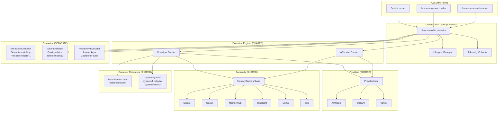
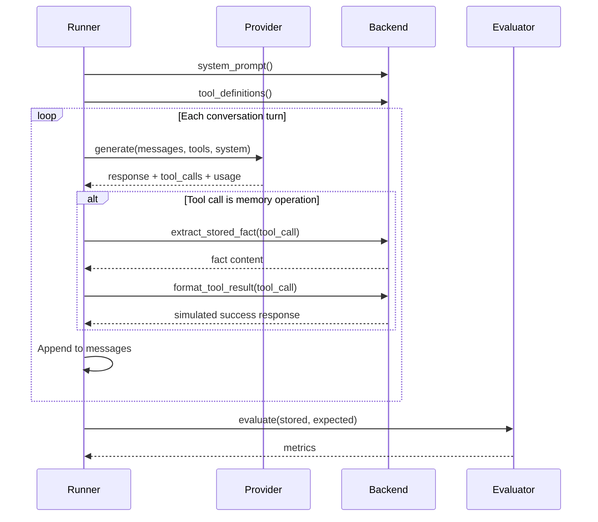
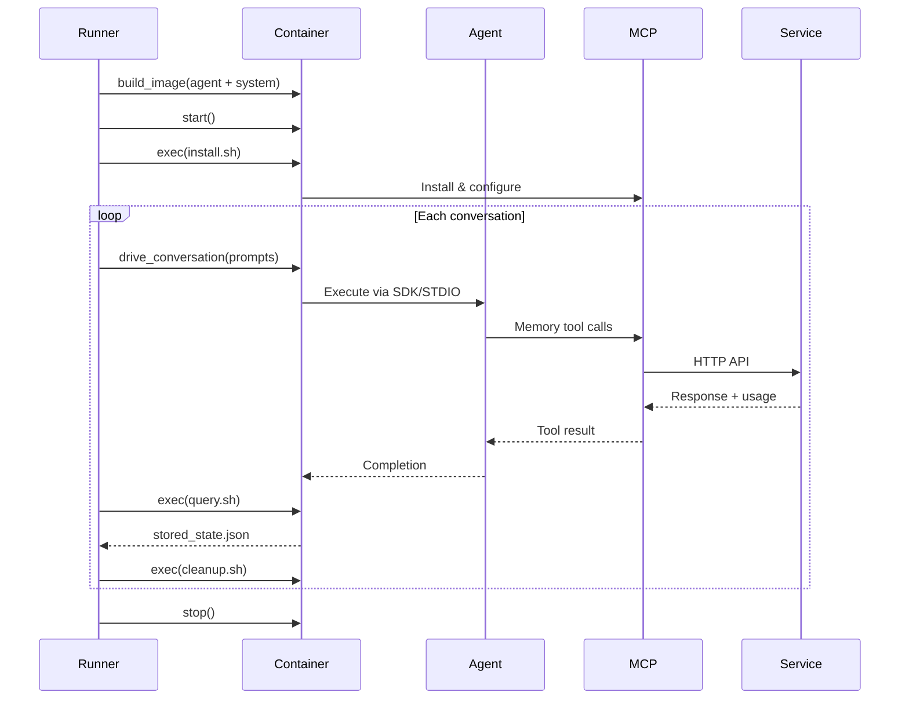

# Unified Benchmarking Harness: Architecture & Implementation Plan

**Date:** 2026-09-28  
**Status:** Design  
**Purpose:** Unified infrastructure for testing memory systems across extraction capability and value benchmarks

---

## Executive Summary

This document defines a shared benchmarking harness that serves two research goals:

1. **llm-memory-bench**: LLM extraction capability, proactive judgment, value measurement
2. **Pavel's runner** (future): Memory system ROI, token efficiency, cost break-even

**Key principles:**
- Shared infrastructure (orchestration, backends, telemetry)
- Separate evaluation logic (extraction metrics vs efficiency metrics)
- One backend implementation serves both projects
- System-native testing (LLMs see vendor interfaces)

**Effort saved:** ~1900 lines + architectural consistency + unified backend maintenance

---

## System Architecture



---

## Execution Modes

### Mode 1: API-Level (Controlled)

**Purpose:** Fast iteration, complete token visibility, controlled experiments



**Characteristics:**
- Runner owns agent loop
- Direct LLM API calls
- Tool calls intercepted, not executed
- Simulated tool responses
- Complete token accounting
- System-native (LLM sees vendor interface)

---

### Mode 2: Containerized (Integration)

**Purpose:** Real-world testing, system isolation, complete environment control



**Characteristics:**
- Real agent (Claude Code / OpenCode)
- Real MCP servers
- Real memory services
- Complete isolation
- System-native (full vendor stack)
- Telemetry from both LLM + service

---

## Core Components

### 1. Unified Memory Backend Interface

```python
# backends/base.py

from abc import ABC, abstractmethod
from dataclasses import dataclass
from typing import Literal

@dataclass
class Scope:
    """Isolation scope for memory operations."""
    user_id: str
    session_id: str | None = None
    namespace: str | None = None


@dataclass
class UsageMetrics:
    """Usage metrics with source tracking."""
    source: Literal["provider", "service", "estimate", "unavailable"]
    input_tokens: int | None = None
    output_tokens: int | None = None
    cached_tokens: int | None = None
    reasoning_tokens: int | None = None
    embedding_tokens: int | None = None
    reflection_tokens: int | None = None
    
    @property
    def is_complete(self) -> bool:
        """True if we have actual data, not estimates or unavailable."""
        return self.source in ("provider", "service")


@dataclass
class RetainResult:
    """Result of storing memories."""
    success: bool
    memory_ids: list[str]
    latency_ms: float
    usage: UsageMetrics | None = None
    error: str | None = None


@dataclass
class RecallResult:
    """Result of retrieving memories."""
    memories: list[dict]
    latency_ms: float
    usage: UsageMetrics | None = None
    error: str | None = None


@dataclass
class ResetResult:
    """Result of clearing memory state."""
    success: bool
    cleared_count: int
    latency_ms: float
    error: str | None = None


class MemoryBackend(ABC):
    """Unified backend interface supporting both API-level and service-level."""
    
    # ===== Metadata =====
    
    @property
    @abstractmethod
    def name(self) -> str:
        """Backend identifier (e.g., 'simple', 'hindsight', 'memoryhub')."""
        pass
    
    @property
    @abstractmethod
    def description(self) -> str:
        """Human-readable description."""
        pass
    
    # ===== Interface Layer (both modes need) =====
    
    @abstractmethod
    def system_prompt(self) -> str:
        """System prompt shown to LLM."""
        pass
    
    @abstractmethod
    def tool_definitions(self) -> list[dict]:
        """MCP tool schemas for LLM (vendor-specific interface)."""
        pass
    
    @abstractmethod
    def accepted_tool_names(self) -> set[str]:
        """Tool names this backend handles (for filtering tool calls)."""
        pass
    
    # ===== API-Level Execution =====
    
    @abstractmethod
    def extract_stored_fact(self, tool_call: ToolCall) -> str:
        """Extract semantic content from tool call (for evaluation)."""
        pass
    
    def format_tool_result(self, tool_call: ToolCall) -> dict:
        """Simulated success response for API-level mode."""
        return {"status": "success"}
    
    # ===== Service-Level Execution =====
    # Default: raise NotImplementedError (backends can override)
    
    def retain(self, facts: list[str], scope: Scope) -> RetainResult:
        """Store facts via service HTTP API."""
        raise NotImplementedError(f"{self.name} does not support service-level retain")
    
    def recall(self, query: str, scope: Scope, limit: int = 10) -> RecallResult:
        """Retrieve facts via service HTTP API."""
        raise NotImplementedError(f"{self.name} does not support service-level recall")
    
    def reset(self, scope: Scope) -> ResetResult:
        """Clear memory state via service API."""
        raise NotImplementedError(f"{self.name} does not support service-level reset")
    
    def telemetry(self) -> UsageMetrics | None:
        """Get cumulative usage from service (if available)."""
        return None
    
    # ===== Optional: Version tracking =====
    
    def version_info(self) -> dict:
        """Version/config info for reproducibility."""
        return {"backend": self.name}
```

**Example implementations:**

```python
# backends/simple.py (API-level only)

class SimpleMemorySystem(MemoryBackend):
    name = "simple"
    description = "Baseline single-tool memory (add_memory)"
    
    def system_prompt(self) -> str:
        return self._prompts["system_prompt"]
    
    def tool_definitions(self) -> list[dict]:
        return [TOOL_DEFINITION]
    
    def accepted_tool_names(self) -> set[str]:
        return {"add_memory"}
    
    def extract_stored_fact(self, tool_call: ToolCall) -> str:
        return tool_call.arguments.get("fact", "")
    
    # Service methods: not implemented (raises NotImplementedError)


# backends/hindsight.py (API + service)

class HindsightBackend(MemoryBackend):
    name = "hindsight"
    description = "Hindsight memory system"
    
    def __init__(self, endpoint: str = "http://hindsight-api:8888"):
        self.endpoint = endpoint
        self._http = httpx.Client(base_url=endpoint)
    
    # Interface layer
    def system_prompt(self) -> str:
        return HINDSIGHT_SYSTEM_PROMPT
    
    def tool_definitions(self) -> list[dict]:
        return HINDSIGHT_TOOLS
    
    def accepted_tool_names(self) -> set[str]:
        return {"hindsight_retain", "hindsight_recall"}
    
    # API-level
    def extract_stored_fact(self, tool_call: ToolCall) -> str:
        return tool_call.arguments.get("fact", "")
    
    def format_tool_result(self, tool_call: ToolCall) -> dict:
        return {"status": "stored", "id": "sim_" + uuid.uuid4().hex[:8]}
    
    # Service-level
    def retain(self, facts: list[str], scope: Scope) -> RetainResult:
        start = time.monotonic()
        response = self._http.post(
            "/retain",
            json={"facts": facts, "scope": scope.__dict__}
        )
        latency = (time.monotonic() - start) * 1000
        
        if not response.is_success:
            return RetainResult(
                success=False,
                memory_ids=[],
                latency_ms=latency,
                error=response.text
            )
        
        data = response.json()
        return RetainResult(
            success=True,
            memory_ids=data.get("ids", []),
            latency_ms=latency,
            usage=self._parse_usage(data.get("usage"))
        )
    
    def recall(self, query: str, scope: Scope, limit: int = 10) -> RecallResult:
        start = time.monotonic()
        response = self._http.post(
            "/recall",
            json={"query": query, "scope": scope.__dict__, "limit": limit}
        )
        latency = (time.monotonic() - start) * 1000
        
        if not response.is_success:
            return RecallResult(
                memories=[],
                latency_ms=latency,
                error=response.text
            )
        
        data = response.json()
        return RecallResult(
            memories=data.get("memories", []),
            latency_ms=latency,
            usage=self._parse_usage(data.get("usage"))
        )
    
    def reset(self, scope: Scope) -> ResetResult:
        start = time.monotonic()
        response = self._http.delete(
            "/memories",
            json={"scope": scope.__dict__}
        )
        latency = (time.monotonic() - start) * 1000
        
        data = response.json() if response.is_success else {}
        return ResetResult(
            success=response.is_success,
            cleared_count=data.get("count", 0),
            latency_ms=latency,
            error=None if response.is_success else response.text
        )
    
    def telemetry(self) -> UsageMetrics | None:
        response = self._http.get("/usage")
        if not response.is_success:
            return None
        return self._parse_usage(response.json())
    
    def _parse_usage(self, data: dict | None) -> UsageMetrics | None:
        if not data:
            return None
        return UsageMetrics(
            source="service",
            input_tokens=data.get("input_tokens"),
            output_tokens=data.get("output_tokens"),
            embedding_tokens=data.get("embedding_tokens"),
        )
```

---

### 2. Benchmark Orchestrator

```python
# orchestrator/bench.py

from dataclasses import dataclass
from enum import Enum
from typing import Protocol

class ExecutionMode(Enum):
    API_LEVEL = "api"
    CONTAINERIZED = "container"


class BenchmarkType(Enum):
    EXTRACTION = "extraction"
    VALUE_SYNTHETIC = "value_synthetic"
    VALUE_REPOSITORY = "value_repository"


@dataclass
class BenchmarkConfig:
    """Unified configuration for all benchmark types."""
    
    # Core
    benchmark_type: BenchmarkType
    execution_mode: ExecutionMode
    
    # Backend
    backend_name: str
    backend_config: dict | None = None
    
    # Provider
    provider_name: str
    model: str
    provider_config: dict | None = None
    
    # Data
    dataset_path: str | None = None
    
    # Limits
    max_conversations: int | None = None
    max_total_tokens: int | None = None
    max_cost_usd: float | None = None
    
    # Container (if execution_mode == CONTAINERIZED)
    agent_name: str | None = None  # "claude-code" or "opencode"
    runtime: str = "docker"  # "docker" or "podman"
    
    # Output
    output_dir: str = "results"


class BenchmarkOrchestrator:
    """Unified orchestrator for all benchmark types and execution modes."""
    
    def __init__(self, config: BenchmarkConfig):
        self.config = config
        self.lifecycle = LifecycleManager()
        self.telemetry = TelemetryCollector()
    
    async def run(self) -> BenchmarkResult:
        """Execute benchmark based on config."""
        
        self.lifecycle.transition_to("initializing")
        
        # Load backend
        backend = self._load_backend()
        
        # Load dataset
        dataset = self._load_dataset()
        
        # Select execution engine
        if self.config.execution_mode == ExecutionMode.API_LEVEL:
            engine = APILevelRunner(
                backend=backend,
                telemetry=self.telemetry
            )
        else:
            engine = ContainerRunner(
                backend=backend,
                agent_name=self.config.agent_name,
                runtime=self.config.runtime,
                telemetry=self.telemetry
            )
        
        self.lifecycle.transition_to("running")
        
        # Execute benchmark
        run_result = await engine.run(dataset, self.config)
        
        self.lifecycle.transition_to("evaluating")
        
        # Select evaluator
        evaluator = self._load_evaluator()
        
        # Evaluate results
        eval_result = await evaluator.evaluate(run_result, dataset)
        
        self.lifecycle.transition_to("completed")
        
        return BenchmarkResult(
            config=self.config,
            run_result=run_result,
            eval_result=eval_result,
            telemetry=self.telemetry.get_summary()
        )
    
    def _load_backend(self) -> MemoryBackend:
        """Load backend based on config."""
        from .backends import get_backend
        return get_backend(
            self.config.backend_name,
            **(self.config.backend_config or {})
        )
    
    def _load_dataset(self):
        """Load dataset based on benchmark type."""
        if self.config.benchmark_type == BenchmarkType.EXTRACTION:
            from .dataset import load_dataset
            return load_dataset(self.config.dataset_path)
        
        elif self.config.benchmark_type == BenchmarkType.VALUE_SYNTHETIC:
            from .value.dataset import load_synthetic_dataset
            return load_synthetic_dataset(self.config.dataset_path)
        
        elif self.config.benchmark_type == BenchmarkType.VALUE_REPOSITORY:
            from .value.repository import load_task_suite
            return load_task_suite(self.config.dataset_path)
    
    def _load_evaluator(self):
        """Load evaluator based on benchmark type."""
        if self.config.benchmark_type == BenchmarkType.EXTRACTION:
            from .extraction.evaluator import ExtractionEvaluator
            return ExtractionEvaluator()
        
        elif self.config.benchmark_type == BenchmarkType.VALUE_SYNTHETIC:
            from .value.evaluator import ValueEvaluator
            return ValueEvaluator()
        
        elif self.config.benchmark_type == BenchmarkType.VALUE_REPOSITORY:
            from .value.repository import RepositoryEvaluator
            return RepositoryEvaluator()
```

---

### 3. Lifecycle Manager

```python
# orchestrator/lifecycle.py

from enum import Enum
from dataclasses import dataclass
from datetime import datetime

class LifecycleState(Enum):
    """Benchmark lifecycle states (from Pavel's spec)."""
    CREATED = "created"
    INITIALIZING = "initializing"
    VALIDATED = "validated"
    PREPARED = "prepared"
    SEEDED = "seeded"  # For value benchmarks with seed session
    RUNNING = "running"
    EVALUATING = "evaluating"
    SCORED = "scored"
    COMPLETED = "completed"
    FAILED = "failed"


@dataclass
class StateTransition:
    from_state: LifecycleState
    to_state: LifecycleState
    timestamp: datetime
    metadata: dict | None = None


class LifecycleManager:
    """Track benchmark execution lifecycle."""
    
    def __init__(self):
        self.current_state = LifecycleState.CREATED
        self.transitions: list[StateTransition] = []
        self.started_at = datetime.utcnow()
    
    def transition_to(self, state: str | LifecycleState, **metadata):
        """Transition to new state."""
        if isinstance(state, str):
            state = LifecycleState(state)
        
        transition = StateTransition(
            from_state=self.current_state,
            to_state=state,
            timestamp=datetime.utcnow(),
            metadata=metadata or None
        )
        self.transitions.append(transition)
        self.current_state = state
    
    def get_history(self) -> list[StateTransition]:
        """Get state transition history."""
        return self.transitions
```

---

### 4. Telemetry Collector

```python
# orchestrator/telemetry.py

from dataclasses import dataclass
from datetime import datetime
from typing import Literal

@dataclass
class TelemetryEvent:
    """Single telemetry event (from Pavel's spec)."""
    event_id: str
    timestamp: datetime
    component: Literal["agent", "memory", "tool", "orchestrator"]
    operation: str
    success: bool
    duration_ms: float
    usage: UsageMetrics | None = None
    metadata: dict | None = None


class TelemetryCollector:
    """Collect and aggregate telemetry events."""
    
    def __init__(self):
        self.events: list[TelemetryEvent] = []
        self._event_counter = 0
    
    def record(
        self,
        component: str,
        operation: str,
        success: bool,
        duration_ms: float,
        usage: UsageMetrics | None = None,
        **metadata
    ) -> str:
        """Record telemetry event, return event_id."""
        event_id = f"evt_{self._event_counter:06d}"
        self._event_counter += 1
        
        event = TelemetryEvent(
            event_id=event_id,
            timestamp=datetime.utcnow(),
            component=component,
            operation=operation,
            success=success,
            duration_ms=duration_ms,
            usage=usage,
            metadata=metadata or None
        )
        self.events.append(event)
        return event_id
    
    def get_summary(self) -> dict:
        """Aggregate telemetry summary."""
        total_input_tokens = 0
        total_output_tokens = 0
        total_embedding_tokens = 0
        incomplete_count = 0
        
        for event in self.events:
            if event.usage:
                if not event.usage.is_complete:
                    incomplete_count += 1
                
                total_input_tokens += event.usage.input_tokens or 0
                total_output_tokens += event.usage.output_tokens or 0
                total_embedding_tokens += event.usage.embedding_tokens or 0
        
        return {
            "total_events": len(self.events),
            "total_input_tokens": total_input_tokens,
            "total_output_tokens": total_output_tokens,
            "total_embedding_tokens": total_embedding_tokens,
            "incomplete_usage_count": incomplete_count,
            "usage_completeness": 1 - (incomplete_count / len(self.events)) if self.events else 1.0
        }
```

---

### 5. API-Level Runner

```python
# orchestrator/api_runner.py

class APILevelRunner:
    """Execute benchmarks in API-level mode (controlled)."""
    
    def __init__(self, backend: MemoryBackend, telemetry: TelemetryCollector):
        self.backend = backend
        self.telemetry = telemetry
    
    async def run(self, dataset, config: BenchmarkConfig) -> RunResult:
        """Execute API-level benchmark."""
        
        # Load provider
        provider = get_provider(config.provider_name, config.model)
        
        # Get backend interface
        system_prompt = self.backend.system_prompt()
        tools = self.backend.tool_definitions()
        accepted_tools = self.backend.accepted_tool_names()
        
        # Budget tracking
        budget = UsageBudget(
            model=config.model,
            max_total_tokens=config.max_total_tokens,
            max_cost_usd=config.max_cost_usd
        )
        
        run_result = RunResult(config=config)
        
        conversations = dataset.conversations
        if config.max_conversations:
            conversations = conversations[:config.max_conversations]
        
        for conversation in conversations:
            conv_result = await self._run_conversation(
                conversation=conversation,
                provider=provider,
                system_prompt=system_prompt,
                tools=tools,
                accepted_tools=accepted_tools,
                budget=budget
            )
            run_result.conversation_results.append(conv_result)
            
            if budget.stopped:
                run_result.stop_reason = "Budget reached"
                break
        
        return run_result
    
    async def _run_conversation(
        self,
        conversation,
        provider,
        system_prompt: str,
        tools: list[dict],
        accepted_tools: set[str],
        budget: UsageBudget
    ) -> ConversationResult:
        """Run single conversation with tool interception."""
        
        result = ConversationResult(conversation_id=conversation.id)
        messages = []
        
        for i, turn in enumerate(conversation.turns):
            messages.append({"role": turn.role, "content": turn.content})
            
            if turn.role != "user":
                continue
            
            # LLM call
            start = time.monotonic()
            response = await provider.generate(
                messages=messages,
                tools=tools,
                system=system_prompt
            )
            latency = (time.monotonic() - start) * 1000
            
            # Record telemetry
            self.telemetry.record(
                component="agent",
                operation="generate",
                success=True,
                duration_ms=latency,
                usage=UsageMetrics(
                    source="provider",
                    input_tokens=response.input_tokens,
                    output_tokens=response.output_tokens
                )
            )
            
            # Filter memory tool calls
            memory_tool_calls = [
                tc for tc in response.tool_calls
                if tc.name in accepted_tools
            ]
            
            turn_result = TurnResult(
                turn_index=i,
                role=turn.role,
                tool_calls=memory_tool_calls,
                input_tokens=response.input_tokens,
                output_tokens=response.output_tokens,
                latency_ms=latency
            )
            result.turn_results.append(turn_result)
            
            budget.record(response.input_tokens, response.output_tokens)
            
            # Build tool result messages (simulated)
            if response.tool_calls:
                tool_msgs = provider.build_tool_result_messages(
                    response,
                    format_tool_result=self.backend.format_tool_result
                )
                messages.extend(tool_msgs)
            else:
                messages.append({"role": "assistant", "content": response.text})
            
            if budget.stopped:
                break
        
        return result
```

---

### 6. Container Runner

```python
# orchestrator/container_runner.py

import subprocess
from pathlib import Path

class ContainerRunner:
    """Execute benchmarks in containerized mode (integration)."""
    
    def __init__(
        self,
        backend: MemoryBackend,
        agent_name: str,
        runtime: str,
        telemetry: TelemetryCollector
    ):
        self.backend = backend
        self.agent_name = agent_name
        self.runtime = runtime  # "docker" or "podman"
        self.telemetry = telemetry
    
    async def run(self, dataset, config: BenchmarkConfig) -> RunResult:
        """Execute containerized benchmark."""
        
        # Build container image
        image_id = self._build_image()
        
        # Start container
        container_id = self._start_container(image_id)
        
        try:
            # Install memory system
            self._install_system(container_id)
            
            run_result = RunResult(config=config)
            
            conversations = dataset.conversations
            if config.max_conversations:
                conversations = conversations[:config.max_conversations]
            
            for conversation in conversations:
                # Drive conversation through agent
                self._drive_conversation(container_id, conversation)
                
                # Query stored state
                stored = self._query_stored(container_id)
                
                # Record for evaluation
                conv_result = ConversationResult(
                    conversation_id=conversation.id,
                    stored_state=stored
                )
                run_result.conversation_results.append(conv_result)
                
                # Cleanup between conversations
                self._cleanup_system(container_id)
            
            return run_result
        
        finally:
            self._stop_container(container_id)
    
    def _build_image(self) -> str:
        """Build Docker/Podman image with agent."""
        host_dir = Path(__file__).parent.parent / "hosts" / self.agent_name
        
        cmd = [
            self.runtime, "build",
            "-t", f"bench-{self.agent_name}:latest",
            str(host_dir)
        ]
        
        result = subprocess.run(cmd, capture_output=True, text=True)
        if result.returncode != 0:
            raise RuntimeError(f"Image build failed: {result.stderr}")
        
        return f"bench-{self.agent_name}:latest"
    
    def _start_container(self, image_id: str) -> str:
        """Start container and return container ID."""
        systems_dir = Path(__file__).parent.parent / "systems" / self.backend.name
        
        cmd = [
            self.runtime, "run", "-d",
            "-v", f"{systems_dir}:/system:ro",
            image_id
        ]
        
        result = subprocess.run(cmd, capture_output=True, text=True)
        if result.returncode != 0:
            raise RuntimeError(f"Container start failed: {result.stderr}")
        
        return result.stdout.strip()
    
    def _install_system(self, container_id: str):
        """Run install.sh in container."""
        cmd = [
            self.runtime, "exec", container_id,
            "/bin/bash", "/system/install.sh"
        ]
        
        result = subprocess.run(cmd, capture_output=True, text=True)
        if result.returncode != 0:
            raise RuntimeError(f"System install failed: {result.stderr}")
    
    def _drive_conversation(self, container_id: str, conversation):
        """Drive conversation through agent."""
        # Implementation depends on agent interface (SDK vs STDIO)
        # For Claude Code: use Agent SDK
        # For OpenCode: write to STDIO
        pass
    
    def _query_stored(self, container_id: str) -> dict:
        """Run query.sh and parse JSON output."""
        cmd = [
            self.runtime, "exec", container_id,
            "/bin/bash", "/system/query.sh"
        ]
        
        result = subprocess.run(cmd, capture_output=True, text=True)
        if result.returncode != 0:
            raise RuntimeError(f"Query failed: {result.stderr}")
        
        return json.loads(result.stdout)
    
    def _cleanup_system(self, container_id: str):
        """Run cleanup.sh in container."""
        cmd = [
            self.runtime, "exec", container_id,
            "/bin/bash", "/system/cleanup.sh"
        ]
        
        result = subprocess.run(cmd, capture_output=True, text=True)
        if result.returncode != 0:
            raise RuntimeError(f"Cleanup failed: {result.stderr}")
    
    def _stop_container(self, container_id: str):
        """Stop and remove container."""
        subprocess.run([self.runtime, "stop", container_id])
        subprocess.run([self.runtime, "rm", container_id])
```

---

## Directory Structure

```
llm_memory_bench/
├── src/llm_memory_bench/
│   ├── orchestrator/              # NEW: Unified orchestration
│   │   ├── __init__.py
│   │   ├── bench.py              # BenchmarkOrchestrator
│   │   ├── lifecycle.py          # Lifecycle state machine
│   │   ├── telemetry.py          # Event collection
│   │   ├── api_runner.py         # API-level execution
│   │   └── container_runner.py   # Container execution
│   │
│   ├── backends/                  # REFACTORED: Unified interface
│   │   ├── __init__.py
│   │   ├── base.py               # MemoryBackend ABC (new unified)
│   │   ├── simple.py             # Migrated to new interface
│   │   ├── gbrain.py             # Migrated to new interface
│   │   ├── memoryhub.py          # Migrated to new interface
│   │   ├── hindsight.py          # NEW: Full API + service
│   │   ├── mem0.py               # NEW: Full API + service
│   │   └── wiki.py               # NEW: Full API + service
│   │
│   ├── providers/                 # UNCHANGED
│   │   ├── base.py
│   │   ├── anthropic.py
│   │   ├── openai.py
│   │   └── vertex.py
│   │
│   ├── extraction/                # EXISTING: Extraction benchmark
│   │   ├── runner.py             # Keep for backward compat (delegate to orchestrator)
│   │   ├── evaluator.py          # Semantic matching, LLM-as-judge
│   │   └── dataset.py            # AlpsBench data model
│   │
│   ├── value/                     # EXISTING: Value benchmarks
│   │   ├── runner.py             # Synthetic scenarios
│   │   ├── evaluator.py          # Quality rubrics
│   │   ├── dataset.py            # Scenario generation
│   │   └── repository/           # NEW: Repository tasks (Pavel's approach)
│   │       ├── runner.py
│   │       ├── evaluator.py
│   │       ├── repository.py
│   │       └── task_suite.py
│   │
│   └── cli.py                     # UPDATED: Use orchestrator
│
├── systems/                       # EXPANDED: Container scripts
│   ├── gbrain/                   # Existing
│   │   ├── install.sh
│   │   ├── query.sh
│   │   └── cleanup.sh
│   ├── claude-code-memory/       # Existing
│   ├── hindsight/                # NEW
│   ├── mem0/                     # NEW
│   └── wiki/                     # NEW
│
├── hosts/                         # EXPANDED: Agent containers
│   ├── claude-code/              # Existing
│   │   ├── Dockerfile
│   │   ├── driver.py
│   │   └── entrypoint.sh
│   └── opencode/                 # NEW
│       ├── Dockerfile
│       ├── driver.py
│       └── entrypoint.sh
│
└── docs/
    ├── architecture.md           # UPDATE with unified design
    ├── unified-harness-architecture.md  # This document
    └── tool-call-filtering.md    # Existing
```

---

## Migration Plan

### Phase 1: Unified Backend Interface (Week 1)

**Goal:** Create new interface without breaking existing code

**Tasks:**

1. **Create new base interface**
   - `backends/base.py` with full `MemoryBackend` interface
   - Include `UsageMetrics`, `RetainResult`, `RecallResult`, `ResetResult` dataclasses
   - Document system-native design principle

2. **Migrate existing backends**
   - Update `simple.py` to inherit from new base
   - Update `gbrain.py` to inherit from new base
   - Update `memoryhub.py` to inherit from new base
   - Add `accepted_tool_names()` method to each
   - Service methods raise `NotImplementedError` (API-level only)

3. **Add new service-level backends** (Pavel implements)
   - `backends/hindsight.py` with full API + service support
   - `backends/mem0.py` with full API + service support
   - `backends/wiki.py` with full API + service support
   - Each includes HTTP client for service API

4. **Update backend registry**
   - `backends/__init__.py` updated with new backends
   - `get_backend()` factory function

5. **Testing**
   - All existing extraction tests pass
   - API-level mode works with migrated backends
   - New backends work in both API and service modes

**Deliverables:**
- ✅ Unified `MemoryBackend` interface
- ✅ All existing backends migrated (backward compatible)
- ✅ 3 new service-level backends implemented
- ✅ Tests passing

---

### Phase 2: Orchestration Layer (Week 1-2)

**Goal:** Build unified orchestrator while keeping old runners functional

**Tasks:**

1. **Create orchestrator components**
   - `orchestrator/bench.py` with `BenchmarkOrchestrator`
   - `orchestrator/lifecycle.py` with `LifecycleManager`
   - `orchestrator/telemetry.py` with `TelemetryCollector`
   - `orchestrator/api_runner.py` with `APILevelRunner`
   - `orchestrator/container_runner.py` with `ContainerRunner`

2. **Update existing runners to delegate**
   - `extraction/runner.py` delegates to `APILevelRunner`
   - `value/runner.py` delegates to `APILevelRunner`
   - Keep old interfaces for backward compatibility

3. **Update CLI**
   - Add `--execution-mode` flag (api | container)
   - Add `--benchmark-type` flag (extraction | value_synthetic | value_repository)
   - Route to orchestrator instead of old runners

4. **Testing**
   - Extraction benchmark via orchestrator
   - Value benchmark via orchestrator
   - Container mode with existing systems (gbrain, claude-code-memory)

**Deliverables:**
- ✅ Unified orchestrator working
- ✅ Old code paths still functional
- ✅ CLI updated
- ✅ Both execution modes tested

---

### Phase 3: Container Infrastructure (Week 2)

**Goal:** Add new memory system containers and OpenCode host

**Tasks:**

1. **Create system install scripts** (Pavel implements)
   - `systems/hindsight/install.sh` (npm install + MCP config)
   - `systems/hindsight/query.sh` (curl to service API)
   - `systems/hindsight/cleanup.sh` (DELETE to service API)
   - Same for `mem0/` and `wiki/`

2. **Create OpenCode host** (Pavel implements)
   - `hosts/opencode/Dockerfile` (OpenCode + dependencies)
   - `hosts/opencode/driver.py` (STDIO gateway)
   - `hosts/opencode/entrypoint.sh`

3. **Test container isolation**
   - Multiple backends in sequence don't contaminate
   - Different user scopes isolated
   - Cleanup fully resets state

4. **Document container requirements**
   - How to write `install.sh`
   - How to write `query.sh` (must output JSON to stdout)
   - How to write `cleanup.sh`

**Deliverables:**
- ✅ Hindsight, Mem0, Wiki system scripts
- ✅ OpenCode host container
- ✅ Isolation tests passing
- ✅ Container documentation

---

### Phase 4: Repository Value Benchmark (Week 3)

**Goal:** Add repository-based value testing (Pavel's approach)

**Tasks:**

1. **Create repository task infrastructure**
   - `value/repository/repository.py` (worktree management)
   - `value/repository/task_suite.py` (task definitions + answer keys)
   - `value/repository/runner.py` (seed + follow-up protocol)
   - `value/repository/evaluator.py` (quality-adjusted efficiency)

2. **Seed session protocol**
   - Define seed prompt structure
   - Memory-writing protocol clarification (see open questions)
   - Telemetry collection during seed

3. **Follow-up task execution**
   - Baseline trial (no memory)
   - Memory trial (with seed session memory)
   - Paired comparison

4. **Quality-adjusted efficiency metrics**
   - Cost per successful task
   - Break-even analysis
   - Quality weighting

**Deliverables:**
- ✅ Repository task suite infrastructure
- ✅ Seed session protocol implemented
- ✅ Repository value benchmark working
- ✅ Example task suite

---

### Phase 5: Integration & Documentation (Week 3-4)

**Goal:** Complete integration and comprehensive docs

**Tasks:**

1. **End-to-end testing**
   - Extraction benchmark: API + container modes
   - Value synthetic: API + container modes
   - Value repository: API + container modes
   - All backends: simple, gbrain, memoryhub, hindsight, mem0, wiki
   - All providers: anthropic, openai, vertex

2. **Cross-contamination tests**
   - Backend A → Backend B in same container (no leakage)
   - User 1 → User 2 in same backend (no leakage)
   - Conversation 1 → Conversation 2 sequential (correct state)

3. **Performance benchmarking**
   - Container startup overhead
   - API-level vs container mode latency
   - Telemetry overhead

4. **Documentation**
   - Update `docs/architecture.md` with unified design
   - Create `docs/backend-authoring.md` (how to add backends)
   - Create `docs/container-systems.md` (how to add systems)
   - Update README with new CLI

5. **Migration guide**
   - For existing llm-memory-bench users
   - For Pavel's runner adoption
   - Breaking changes (if any)

**Deliverables:**
- ✅ Full test coverage
- ✅ Comprehensive documentation
- ✅ Migration guide
- ✅ Performance benchmarks

---

## Open Questions

### 1. Controlled Mode Design (Critical)

**Question:** For API-level / controlled mode, should it be:

**Option A (Recommended): System-Native**
- LLM sees vendor-specific prompts and tools
- Different backends expose different interfaces
- Tests complete system (interface + backend)
- Consistent with container mode

**Option B: Backend-Agnostic**
- LLM sees generic interface
- Backend extracts from raw conversation events
- Tests backend extraction only, not interface design
- Per Pavel's spec language: "agent loop must not choose different tools based on backend"

**Impact:** Determines what we measure (full system vs extraction capability)

**Recommendation:** Option A (system-native) for consistency with container mode

---

### 2. Memory Writing Protocol in Seed Session

**Question:** In repository value benchmark seed session, how does memory get written?

**Option 1: Tool calls**
- LLM explicitly calls `retain_memory(fact)` tools
- Seed prompt teaches when to call tools
- Clear semantic extraction

**Option 2: Structured output**
- LLM formats responses with metadata
- Runner extracts and calls `backend.retain()`
- More flexible formatting

**Option 3: Post-hoc extraction**
- Runner collects all conversation events
- Backend service extracts from unstructured events
- Like AlpsBench approach

**Impact:** Determines adapter interface design

**Recommendation:** Defer to Pavel, but Option 1 aligns with system-native principle

---

### 3. Telemetry Aggregation Across Services

**Question:** How to aggregate usage when both LLM provider AND memory service have tokens?

**Example:**
- Anthropic API: 10k input, 5k output
- Hindsight service: 2k embedding, 1k reflection

**Options:**
1. Sum all tokens (13k total)
2. Track separately (10k LLM + 3k service)
3. Weight differently (LLM full price, service discounted)

**Impact:** Cost estimation, break-even analysis

**Recommendation:** Track separately with source field, aggregate only for display

---

### 4. Scope Hierarchy for Isolation

**Question:** What scope levels do we need?

**Current `Scope` dataclass:**
```python
@dataclass
class Scope:
    user_id: str
    session_id: str | None
    namespace: str | None
```

**Questions:**
- Is `user_id` enough for extraction benchmark? (probably yes, each run = new user)
- Does repository benchmark need `project_id`? (seed session tied to repo)
- Should `namespace` be hierarchical? (`team/project/session`)

**Impact:** Isolation guarantees, cleanup granularity

**Recommendation:** Start simple (user_id + session_id), extend if needed

---

## Success Criteria

### Technical

- [ ] All 3 benchmark types work in both execution modes
- [ ] All backends implement unified interface
- [ ] Telemetry captures usage source correctly
- [ ] Container isolation verified (no cross-contamination)
- [ ] Existing extraction benchmark results unchanged (regression test)
- [ ] Service-level backends report usage metrics

### Quality

- [ ] Code coverage > 80%
- [ ] Documentation complete (architecture, authoring guides)
- [ ] Example task suites for all benchmark types
- [ ] Performance acceptable (container startup < 30s)

### Collaboration

- [ ] Pavel can add backends without touching orchestrator
- [ ] Pavel can add task suites without touching runner
- [ ] Shared components benefit both projects
- [ ] Clear ownership boundaries (shared vs separate)

---

## Next Steps

1. **Immediate (This Week)**
   - [ ] Pavel reviews architecture design
   - [ ] Confirm controlled mode approach (Option A vs B)
   - [ ] Confirm memory writing protocol for seed session
   - [ ] Agree on directory structure

2. **Phase 1 Start (Week 1)**
   - [ ] Create unified `backends/base.py`
   - [ ] Migrate existing backends to new interface
   - [ ] Pavel starts Hindsight/Mem0/Wiki backends

3. **Phase 2 Start (Week 1)**
   - [ ] Create orchestrator components
   - [ ] Test extraction benchmark via orchestrator
   - [ ] Test value benchmark via orchestrator

4. **Regular Sync**
   - Weekly checkpoint on shared infrastructure
   - Raise blockers early
   - Document design decisions as they're made

---

## Appendices

### A. Example CLI Usage

```bash
# Extraction benchmark - API mode
llm-memory-bench extract \
  --backend simple \
  --provider anthropic \
  --model claude-sonnet-4-5 \
  --dataset datasets/alpsbench.yaml \
  --execution-mode api

# Extraction benchmark - Container mode
llm-memory-bench extract \
  --backend gbrain \
  --agent claude-code \
  --dataset datasets/alpsbench.yaml \
  --execution-mode container

# Value benchmark - Synthetic scenarios
llm-memory-bench value \
  --benchmark-type synthetic \
  --backend hindsight \
  --provider openai \
  --model gpt-4o \
  --dataset scenarios/quick-demo-v2/ \
  --execution-mode api

# Value benchmark - Repository tasks (Pavel's approach)
llm-memory-bench value \
  --benchmark-type repository \
  --backend memoryhub \
  --agent opencode \
  --task-suite tasks/python-refactoring.yaml \
  --execution-mode container
```

### B. Example Backend Registration

```python
# backends/__init__.py

from .base import MemoryBackend
from .simple import SimpleMemorySystem
from .gbrain import GBrainMemorySystem
from .memoryhub import MemoryHubSystem
from .hindsight import HindsightBackend
from .mem0 import Mem0Backend
from .wiki import WikiBackend

BACKENDS = {
    "simple": SimpleMemorySystem,
    "gbrain": GBrainMemorySystem,
    "memoryhub": MemoryHubSystem,
    "hindsight": HindsightBackend,
    "mem0": Mem0Backend,
    "wiki": WikiBackend,
}

def get_backend(name: str, **kwargs) -> MemoryBackend:
    if name not in BACKENDS:
        raise ValueError(
            f"Unknown backend: {name}. "
            f"Available: {', '.join(BACKENDS.keys())}"
        )
    return BACKENDS[name](**kwargs)
```

### C. Example Container System Structure

```
systems/hindsight/
├── install.sh          # Install Hindsight MCP server
├── query.sh            # Query stored memories (JSON to stdout)
├── cleanup.sh          # Reset state
├── README.md           # Backend-specific documentation
└── config/
    └── hindsight.json  # Default MCP configuration
```

### D. Backward Compatibility

**Old code path (still works):**
```python
# extraction/runner.py
from ..config import RunConfig
from ..dataset import Dataset

async def run_benchmark(dataset: Dataset, config: RunConfig):
    # Delegates to orchestrator internally
    from ..orchestrator import BenchmarkOrchestrator, BenchmarkConfig
    
    orch_config = BenchmarkConfig(
        benchmark_type=BenchmarkType.EXTRACTION,
        execution_mode=ExecutionMode.API_LEVEL,
        backend_name=config.system,
        provider_name=config.provider,
        model=config.model,
        # ... map old config to new
    )
    
    orchestrator = BenchmarkOrchestrator(orch_config)
    return await orchestrator.run()
```

**New code path:**
```python
# Direct orchestrator usage
from llm_memory_bench.orchestrator import BenchmarkOrchestrator, BenchmarkConfig

config = BenchmarkConfig(
    benchmark_type=BenchmarkType.EXTRACTION,
    execution_mode=ExecutionMode.API_LEVEL,
    backend_name="hindsight",
    provider_name="anthropic",
    model="claude-sonnet-4-5"
)

orchestrator = BenchmarkOrchestrator(config)
result = await orchestrator.run()
```
