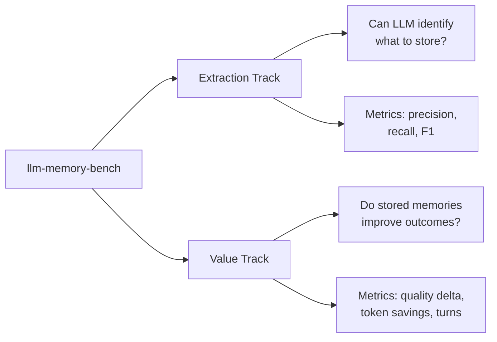

# Value Benchmarking

**Separate from extraction benchmarking.** This measures whether memories actually improve task outcomes, not whether the LLM stores the right facts.

## Two Benchmark Tracks



## Extraction vs Value

| Dimension | Extraction Track | Value Track |
|-----------|-----------------|-------------|
| **Question** | When should the agent store? | Does memory improve tasks? |
| **Dataset** | AlpsBench Task 1 (per-turn ground truth) | AlpsBench Task 2 → generated scenarios |
| **Commands** | `run`, `evaluate`, `compare` | `value-generate*`, `value-run`, `value-evaluate` |
| **Metrics** | Precision, recall, noise resistance | Quality delta, token efficiency, turn compression |
| **Ground truth** | Which facts to store at each turn | Whether response uses memory effectively |

## Value Generation Strategies

### 1. LLM-generated (`value-generate`)

**Uses:** LLM to generate task prompts and explicit outcomes from memories

**Pros:** Flexible, can create diverse scenarios

**Cons:** Slow, costs tokens, may generate irrelevant tasks

**When to use:** Research evaluations, need diverse coverage

```bash
llm-memory-bench value-generate \
  --source alpsbench \
  --max-scenarios 50 \
  --output scenarios/generated
```

### 2. Template-based (`value-generate-quick`)

**Uses:** Pre-defined templates for high-value memory types

**Pros:** Fast (no API calls), guaranteed relevant, demonstrates value clearly

**Cons:** Less diverse, limited to template categories

**When to use:** Quick demos, showing quantitative value, prototyping

```bash
llm-memory-bench value-generate-quick \
  --max-scenarios 100 \
  --output scenarios/quick
```

## File Organization

```
value/
├── README.md              # This file
├── dataset.py             # ValueDataset, ValueScenario models
├── runner.py              # Run paired trials (baseline vs memory)
├── evaluator.py           # Run outcome validators and compute comparisons
├── metrics.py             # Compute value metrics
└── generator_targeted.py  # Template-based scenario generation
```

## Outcomes and validators

Scenarios describe the result being evaluated separately from the mechanism used to evaluate it. An outcome is a specific statement about what the task should produce. A validator inspects a trial and returns evidence for one or more outcomes.

```yaml
outcomes:
  - id: typed_solution
    statement: "The code uses strict type hints."

validators:
  - type: llm_judge
```

The initial implementation supports `llm_judge`. Validator results are stored as extensible records with a status, optional score, explanation, and validator-specific evidence. Tokens, turns, latency, and cost remain universal instrumentation metrics, separate from outcome measurements.

Adapters in `../adapters/` that start with `alpsbench_value*` are also part of value benchmarking but kept with other adapters for consistency.

## Output

Value runs produce different output than extraction runs:

**Extraction output:**
```json
{
  "config": {...},
  "conversations": [
    {
      "id": "conv_1",
      "tool_calls": [...],  // What was stored
      "ground_truth": [...] // What should be stored
    }
  ]
}
```

**Value output:**
```json
{
  "config": {...},
  "scenario_results": [
    {
      "scenario_id": "test-001",
      "trials": {
        "baseline": {
          "turns": [...],
          "final_response": "...",
          "agent_tokens": 1234
        },
        "memory_prompt": {
          "turns": [...],
          "final_response": "...",
          "agent_tokens": 567,
          "memory_tokens": 100
        }
      }
    }
  ]
}
```

## Quick Start

```bash
# 1. Generate scenarios (fast, template-based)
llm-memory-bench value-generate-quick \
  --max-scenarios 50 \
  --output scenarios/demo

# 2. Run paired trials
llm-memory-bench value-run \
  --scenarios scenarios/demo/alpsbench-value-targeted.yaml \
  --system simple \
  --mode prompt \
  --max-turns 5

# 3. View results
# (evaluation step coming soon)
```

The default provider and model are OpenAI `gpt-4o`. Set `OPENAI_API_KEY` before running, or override them with `--provider` and `--model`.

During a run, the outcome judge evaluates each agent response. The trial stops early when all declared outcomes pass. Use `--no-judge-during-run` to disable this completion check while retaining the final evaluation.

## Metrics Explained

See [metrics.py](metrics.py) for implementation.

**Token efficiency:**
- `baseline_agent_tokens` - Tokens used without memory
- `memory_agent_tokens` - Tokens used with memory
- `memory_overhead_tokens` - Cost of injecting memory
- `effective_token_savings` - Net savings after overhead
- `token_efficiency_ratio` - baseline / memory (>1.0 = savings)

**Turn efficiency:**
- `baseline_turns` - Conversation turns without memory
- `memory_turns` - Conversation turns with memory
- `turn_compression` - baseline / memory (>1.0 = fewer turns)
- `questions_asked` - Clarifying questions (fewer = better)

**Quality:**
- `quality_baseline` - LLM judge score [0-1] without memory
- `quality_memory` - LLM judge score [0-1] with memory
- `quality_delta` - Improvement (+) or degradation (-)

**ROI:**
- `value_per_token` - quality_delta / memory_overhead
